# QRAM与分布式Grover：线路细节、相位约定与可行性说明

本文把线路直接写在Markdown中：既给可讲述的逻辑，也给可逐门核对的序列、实际冻结参数、完整执行层表与数据出处。配套[带图分析报告](results/REPORT.md)和[PDF](results/线路可行性_相干脉冲验证报告.pdf)保留；本文补充此前正文略写的实现细节。

所有箭头和代码块都按**时间从左向右、从上向下**阅读；公式中的矩阵乘积仍按右侧先作用。除特别注明外，角度用rad，时间用ns。

## 1. 本次证明的是什么

我们要构造固定的QRAM查询线路：输入地址可以叠加，数据库内容只由存储位初态决定；查询后地址和数据正确，临时树恢复。将数据制备为负号态后，同一查询成为Grover的相位oracle。

当前主结果关闭T1/T2耗散、附加随机门错误、准备翻转、读出混淆和有限shots重建。保留冻结脉冲本身的失谐、非理想旋转、高能级条件相位和相干泄露。因此这里只讨论线路可行性及其相干实现基线。

| 证据层次 | 具体做法 | 能支持的结论 |
| --- | --- | --- |
| 理想原生矩阵 | 展开CZ、01/12旋转和虚拟参考帧，逐项相乘 | 允许门集和规定入口能给出正确query |
| 局域四能级脉冲 | 四个Duffing振子，平滑耦合与频率轨迹，冻结门库传播 | 参考节点的相位、人口、泄露与回程可评估 |
| 完整模块过程 | 将局域传播过程嵌入树，模块外门使用理想01过程延拓 | 在这些接口假设下，查询及单轮Grover可组合 |

这不是一套共享参数的17体连续Hamiltonian仿真，也不是真机数据。图中高保真度不能直接当作真实芯片保证。

阅读入口：第2–4节定义门；第5–7节解释R5/R6及2态；第8–10节搭建完整query；第11–12节给具体参数和逐门表；第13–15节核对性能、资源与复现方式。

## 2. 四线次序、合法入口和目标矩阵

一个router的线序固定为`C,I,L,R`：控制、输入、左输出、右输出。`C=0`送左，`C=1`送右。

下行入口只要求

$$
|c,i,0,0\rangle\longmapsto
\begin{cases}
|0,0,i,0\rangle,&c=0,\\
|1,0,0,i\rangle,&c=1.
\end{cases}
$$

在按序排列的四列合法入口、四行目标像之间，理想映射矩阵就是单位矩阵：

$$
\begin{array}{c|cccc}
  &0000&0100&1000&1100\\\hline
0000&1&0&0&0\\
0010&0&1&0&0\\
1000&0&0&1&0\\
1001&0&0&0&1
\end{array}.
$$

这是四维子空间到四维子空间的等距映射。四个入口的任意复数叠加都必须正确；只检查四个输出人口还不够。**它不是对所有16个计算基入口定义的通用四位受控交换。**

上行在下行的合法像空间上实现反向映射：`0000→0000, 0010→0100, 1000→1000, 1001→1100`。本次另外检查实际down输出接实际up，避免理想入口掩盖前一步的偏离。

## 3. 门符号、相位与CNOT的实际展开

单门不是无相位的能级置换。在目标跃迁的有序基`|j>,|j+1>`中，定义

$$
R_{j,j+1}(\theta,\phi)=
\begin{pmatrix}
\cos(\theta/2)&-i e^{-i\phi}\sin(\theta/2)\\
-i e^{i\phi}\sin(\theta/2)&\cos(\theta/2)
\end{pmatrix}.
$$

`X01(φ)`表示`R01(π,φ)`，`X01/2(φ)`表示`R01(π/2,φ)`，`X12(φ)`表示`R12(π,φ)`。默认未写φ时为0。`+Y/2`是φ=+π/2的01半门，`−Y/2`是φ=−π/2。

π脉冲在被驱动二能级块中是`−iX`。当第三能级是旁路时，这个`−i`会变为可观测的分支相位，不能随手丢掉。

只有CZ是原生两比特门。CNOT的名义时间序列为

```text
CNOT(a→b):  X01/2_b(−π/2) → CZ(a,b) → X01/2_b(+π/2)
              单门层         CZ层          单门层
```

对01空间，矩阵为

$$
C_{a\to b}=R_y^{(b)}(\pi/2)\,CZ_{ab}\,R_y^{(b)}(-\pi/2).
$$

实际CZ自己的原生相位补偿也由门库累加到帧缓冲。因此“两个半门夹CZ”还必须带上同一套CZ校准和相位约定；不能只取裸波形而省掉补偿。

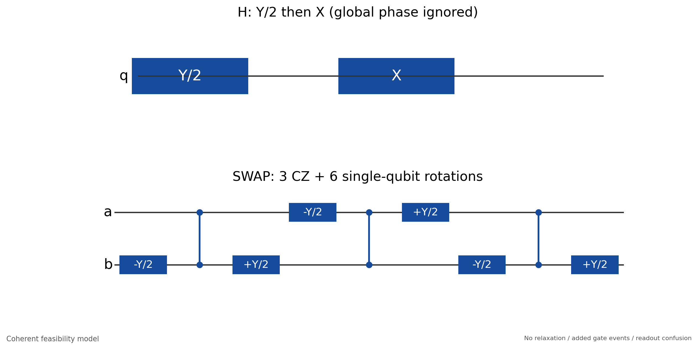

原生展开：CNOT、H和完整SWAP。图中X是原生X01，单门层与CZ层隔离。

## 4. 搬运、完整SWAP和H分别是什么

**两CNOT搬运**记为`T(a→b)`：

```text
T(a→b): CNOT(a→b) → CNOT(b→a)
```

接收端为0时，它把`(α|0>+β|1>)_a |0>_b`搬为`|0>_a (α|0>+β|1>)_b`，用2个CZ、4个半门。如果接收端未知，这不是完整SWAP。

对任意01二比特输入，完整SWAP为

```text
S(a,b): CNOT(a→b) → CNOT(b→a) → CNOT(a→b)
```

它用3个CZ、6个半门，名义9个物理层。此处的完整是指**01计算空间**，不表示交换任意qutrit态。

外部QPU所需的H也实际展开：

```text
H(q): X01/2_q(+π/2) → X01_q(0)
```

对01空间有`Rx(π)Ry(π/2)=−iH`。公共全局相位不影响本任务；若高能级也有振幅，应使用整个展开的真实延拓，不能自动当成标准H⊕I。H用两个物理脉冲、两个单门层，不是免费门。

## 5. R5下行：五个CZ如何完成路由

先定义编码块`E`，单门均作用在输入I上，中间的CNOT受C控制：

```text
E: X01(I) → X12(I) → CNOT(C→I) → X12(I) → X01(I)
```

冻结参数下的R5 down完整宏观顺序是

```text
E
→ V_down(I)
→ T(I→L)
→ V_down†(L)
→ X12(I)
→ T(I→R)
→ 输出端点帧 F_C(φc), F_L(φl), F_R(φr)
```

`V`是只在01空间混合的单比特酉矩阵，目标012作用为`V⊕1`（允许公共全局相位）；不是两比特门。它在当前实现中由两个01半门和两跃迁参考帧展开。更高能级的作用由展开及实际脉冲决定。

1个编码CNOT、2个左搬运CNOT、2个右搬运CNOT，共5个CZ。当前V展开后共有19个物理单门。并行规则下，down和up各18个物理层。

### 5.1 先看理想CZ旁路：为什么会路由到正确端口

暂取`V=I`，CZ在含2态的旁路上取恒等，保留π脉冲的`−i`。先只看C、I的能级：

| 初态CI | E后CI（含分支相位） | 左搬运后C,I,L,R | X12(I)与右搬运后 |
| --- | --- | --- | --- |
| 00 | `+|00>` | `+|0000>` | `+|0000>` |
| 01 | `−|01>` | `−|0010>` | `−|0010>` |
| 10 | `+|10>` | `+|1000>` | `+|1000>` |
| 11 | `−|12>` | `−|1200>` | `+i|1001>` |

`C=0,I=1`的激发被左搬运取走；`C=1,I=1`暂存为I的2态，绕开左搬运，再由X12变回1，送往右端。理想端点帧`(φc,φl,φr)=(0,−π,+π/2)`消去表中的相对相位，得到第2节的目标等距映射。

这些是理想矩阵解，不是下一节物理脉冲的冻结端点角度。不能拿理想值替换真实校准值。

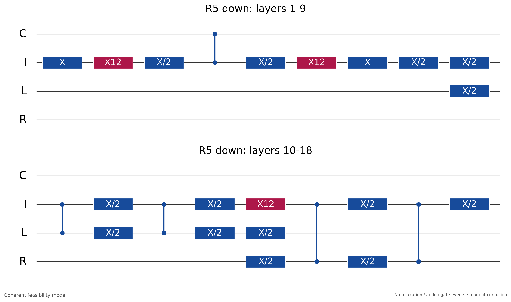

R5 down的原生门线路。两行连续执行；实际轴和虚拟参考帧见第12节。

### 5.2 真实2态为什么要用配对V，而非只补末端Z

01校准主要固定CZ的条件组合`χ11−χ10−χ01+χ00≈π`；它不同时固定`χ21−χ20`。这里第一位是临时含2态的控制线，第二位是目标线，顺序反过来时应改写成`χ12−χ02`。

经过目标两侧的±Y/2，含2态分支看到的块近似为

$$
B=R_y(\pi/2)\begin{pmatrix}e^{i\chi_{20}}&0\\0&e^{i\chi_{21}}\end{pmatrix}R_y(-\pi/2).
$$

因此它可以把接收端`|0>`转成`a|0>+b|1>`。这已经改变人口，末端对角虚拟Z只能改相位，无法将任意非零b变回0。并非“2态把已经校准的11相位一定弄坏了”，而是线路进入了校准不限定的20/21扇区。

对整个左搬运`K=T(I→L)`，把这条辅助路径的目标块记为M。近似封闭且泄露小的时候，有

$$
K|2,0\rangle\simeq |2\rangle M|0\rangle,
\qquad V|0\rangle=M|0\rangle
$$

（若M近似有公共幅度与相位，匹配的是归一化后的方向，残余分支相位再标定）。在前置V(I)与后置V†(L)之间：

$$
\begin{aligned}
|\psi,0\rangle&\xrightarrow{V(I)}|V\psi,0\rangle
  \xrightarrow{K}|0,V\psi\rangle
  \xrightarrow{V^\dagger(L)}|0,\psi\rangle,\\
|2,0\rangle&\xrightarrow{V(I)}|2,0\rangle
  \xrightarrow{K}|2\rangle M|0\rangle
  \xrightarrow{V^\dagger(L)}|2,0\rangle.
\end{aligned}
$$

第一行说明正常搬运保留；第二行说明辅助路径被恢复。两行结论是近似的，依赖`L初始为0`、所截取辅助块近似封闭、实际计算空间搬运接近理想。漏出该块的振幅不能靠这个单比特旋转恢复。V也不是一个自动消除所有含2态相位的万能补偿。

这就是当前R5采用的“配对单门匹配”。它没有回波中新增的CZ，利用的是受限入口，不是通用完整CSWAP恒等式。仅用输出虚拟Z足够的条件，是人口路径已经正确，只剩能分解为局域相位的误差。V先处理目标旋转，端点帧再处理剩余相对相位，两者任务不同。

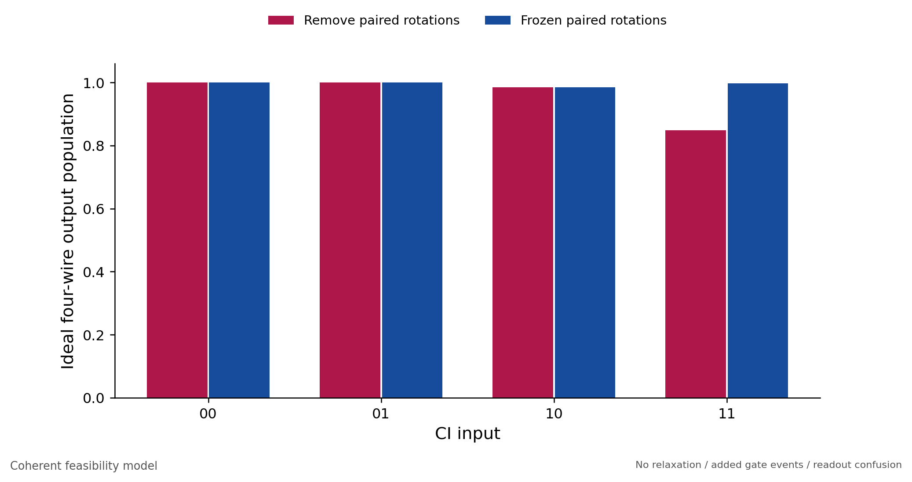

固定其他冻结参数，移除R5配对V的消融；右路分支人口明显下降，说明这不是单纯末端相位问题。

## 6. R5上行：同一物理CZ，单独校准回程

```text
输入端点帧 F_C(φc), F_L(φl), F_R(φr)
→ T(R→I)
→ X12(I)
→ V_up†(L)
→ T(L→I)
→ V_up(I)
→ reverse_same_cz(E)
```

`V_up`来自上行参数JSON，不能默认等于`V_down`，也不能把实际down矩阵直接取共轭转置来代替真实上行。端点相位下行放输出端、上行放输入端，位置不可混用。

`reverse_same_cz`具体执行：倒转门的时间顺序；01半门轴相位加π并折回主值；显式虚拟帧取反；01/12 π脉冲与CZ仍使用同一物理脉冲。因此**它不是完整多能级传播子的数学dagger**。π脉冲在目标子空间的逆与同脉冲相差符号，这在有旁路能级时未必是全局相位；实际CZ也不保证在全部高能级上自逆。独立上行参数和实际往返检验就是为处理这些差异。

## 7. R6：六个CZ的另一种编码与搬运

R6 down的原生宏观序列按顺序为

```text
CNOT(I→L)
→ X01(I) → X12(I)
→ CNOT(C→I)
→ X12(I) → X01(I)
→ CNOT(L→I)
→ X12(I)
→ CNOT(I→L)
→ CNOT(I→R)
→ CNOT(R→I)
→ 输出端点帧 F_C(φc), F_L(φl), F_R(φr)
```

R6 up先加输入端点帧，再执行上述裸序列的`reverse_same_cz`。按CNOT宏表示，其时间顺序为

```text
输入端点帧
→ CNOT(R→I) → CNOT(I→R) → CNOT(I→L)
→ X12(I) → CNOT(L→I)
→ X01(I) → X12(I) → CNOT(C→I)
→ X12(I) → X01(I) → CNOT(I→L)
```

每个方向6个CZ、17个物理单门、19个物理层，不需要R5的配对V参数。它仍会临时使用2态，且真实CZ仍可能有高能级相位和泄露；“不用V”不等于这些物理作用消失。该顺序在规定入口上可实现正确映射，具体波形是否足够好要看逐门传播、端点校准及往返数据。

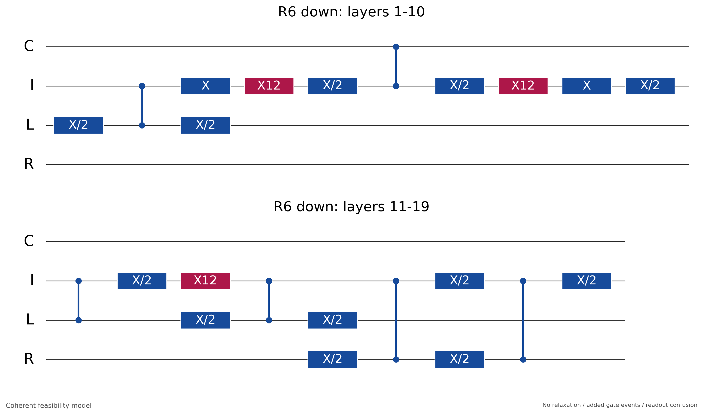

R6 down的原生门线路。门表中的名义相位和运行时参考帧共同决定实际轴。

## 8. 单个router如何接成四地址QRAM

两层树的17个角色如下。端口名`T1/T2`与寿命时间T1/T2无关。

| 组别 | 角色 | 数量 |
| --- | --- | --- |
| 外部QPU | A0、A1、D | 3 |
| 树控制 | C0、C1、C2 | 3 |
| 树数据端口 | T0、T1、T2、L00、L01、L10、L11 | 7 |
| 经典数据库位 | M00、M01、M10、M11 | 4 |

| 节点 | C | I | L | R |
| --- | --- | --- | --- | --- |
| 根 | C0 | T0 | T1 | T2 |
| 左子 | C1 | T1 | L00 | L01 |
| 右子 | C2 | T2 | L10 | L11 |

根与子节点共享T1、T2物理端口；左右子节点四线互不重叠，可以并行。同一局域参考的I、L频率不能直接同时复制给这个共享端口。真实系统需按各节点工作点分别标定，必要时加入频率转场及相位补偿。

外部连边还需要`A0−D, A1−D, A0−A1, D−T0`。其中只把`D−T0`计为跨片网关；叶端各有`Lj−Mj`固定存储CZ。

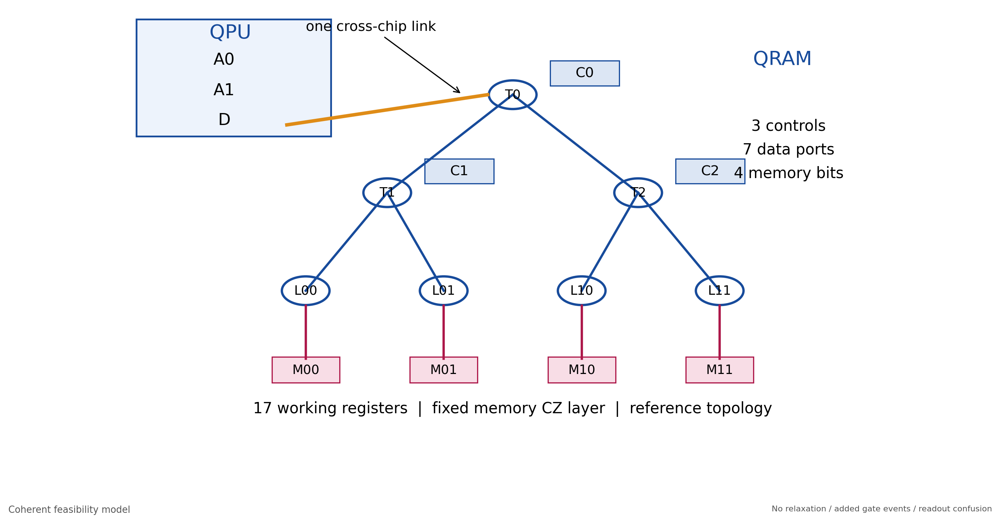

角色与连边。17个物理角色中，当前量子传播显式保留13个四能级站点，4个基态存储位作精确条件收缩。

### 8.1 远程地址网关G为何需要三次SWAP

对j=0或1，定义

```text
G(Aj): S(Aj,D) → S(D,T0) → S(Aj,D)
```

它交换Aj与T0，同时恢复中间位D。按三个初始态标签`(a,d,t)`跟踪：

```text
(a,d,t) → (d,a,t) → (d,t,a) → (t,d,a)
```

该恒等式在线性扩展后对任意01叠加和纠缠同样成立。每个G含3个完整SWAP，即9个CZ；只有中间S(D,T0)中的3个CZ计为跨片。

## 9. 一次完整query：按此顺序执行

开始时临时树`C0,C1,C2,T0,T1,T2,L00,L01,L10,L11`全0；数据库M固定为四位经典基态。A0、A1、D可在任意01输入态（本次已验证完整三输入query）。`||`表示同层并行，其他箭头均串行。

| 步 | 时间顺序中的操作 | 目的及入口约束 |
| --- | --- | --- |
| 1 | G(A0) | A0送至根输入T0，D恢复 |
| 2 | S(T0,C0) | 地址高位存入根控制，T0回0 |
| 3 | G(A1) | 地址低位送至T0，D恢复 |
| 4 | 根router down | 按C0把低位送到T1或T2 |
| 5 | S(T1,C1) &#124;&#124; S(T2,C2) | 按分支保存低位，两条数据端口回0 |
| 6 | H(D)=Y01/2(D)→X01(D) | 把异或读取转换到相位作用形式 |
| 7 | S(D,T0) | 数据进入根；这一SWAP跨片 |
| 8 | 根router down | 数据选择左/右子树 |
| 9 | 左router down &#124;&#124; 右router down | 数据到对应叶端；各接收端初始0 |
| 10 | CZ(L00,M00) &#124;&#124; CZ(L01,M01) &#124;&#124; CZ(L10,M10) &#124;&#124; CZ(L11,M11) | 固定四门，产生数据与内容条件相位 |
| 11 | 左router up &#124;&#124; 右router up | 数据返回T1/T2，叶端恢复 |
| 12 | 根router up | 数据返回T0 |
| 13 | S(D,T0) | 数据返回外部，跨片 |
| 14 | S(T1,C1) &#124;&#124; S(T2,C2) | 取出地址低位，子控制恢复 |
| 15 | 根router up | 地址低位返回T0 |
| 16 | G(A1) | A1恢复 |
| 17 | S(T0,C0) | 取出地址高位，根控制恢复 |
| 18 | G(A0) | A0恢复，临时树回零 |
| 19 | H(D)=Y01/2(D)→X01(D) | 解码到异或读取 |

步1–5是地址加载，步14–18按相反逻辑顺序卸载。此协议共调用8个router：根4次，左、右各2次；下行4次、上行4次。地址卸载要使用独立校准的up，不能把一个有残差的down矩阵在数值上直接取dagger当作真能执行的回程。

资源表还含一层32 ns入口等待；它不是实际输入态制备的完整脉冲。输入态在本次模拟中直接初始化。

### 9.1 为什么访问四个存储CZ却只读到一个地址

路由后地址a对应的叶端携带数据位x，其他叶端为0。因此全部固定存储CZ共同给出的相位为

$$
(-1)^{\sum_j n_{L_j}m_j}=(-1)^{xm_a}.
$$

理想返回恢复临时树后，两侧H将这一作用变为

$$
Q_m|a,d\rangle=|a,d\oplus m_a\rangle.
$$

以`M00M01M10M11=0010`为例，有

$$ Q_{0010}=\operatorname{diag}(I_2,I_2,X,I_2) $$

（基序`|000>,|001>,…,|111>`，前两位为地址）。只有地址10的数据位被翻转。改变数据库只改变M的初态，路由和四个存储CZ均不改。

模拟中将处于已知基态的M收缩为叶端Z或I，是对固定存储CZ的精确条件计算；没有因此删去实际门计划中的存储CZ及其计数。

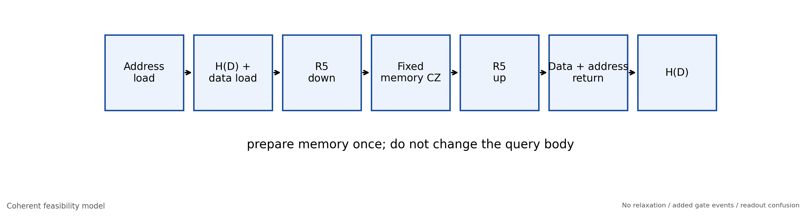

从地址保存到恢复的完整query流程；卸载顺序和辅助回零与读取本身同样重要。

## 10. 同一query如何闭合一轮Grover

把入口直接制备成`|+>_A0 |+>_A1 |−>_D`，其中`|−>=(|0>−|1>)/√2`。同一异或query具有相位回踢：

$$
Q_m|a,-\rangle=(-1)^{m_a}|a,-\rangle.
$$

查询后的地址扩散按以下物理顺序执行：

```text
H(A0) || H(A1)       每个H都展开为Y/2→X，共两层
→ X01(A0) || X01(A1)
→ CZ(A0,A1)
→ X01(A0) || X01(A1)
→ H(A0) || H(A1)     再次展开为两层
```

这个地址算子与`2|++><++|−I`只差一个公共负号。对四选一one-hot数据库，理想一轮即到目标地址。四个目标分别使用`1000,0100,0010,0001`存储制备，主体query和diffusion完全相同，没有把目标地址预编入线路。

如果需要用门制备入口，01空间可用Y/2制备+，用−Y/2制备−；数据库1可由原生X01制备。**这些实际入口制备脉冲未计入当前报告的query/Grover资源和控制误差**，当前图中的入口是理想初始化。实验总开销需另计初始化、复位和读出。

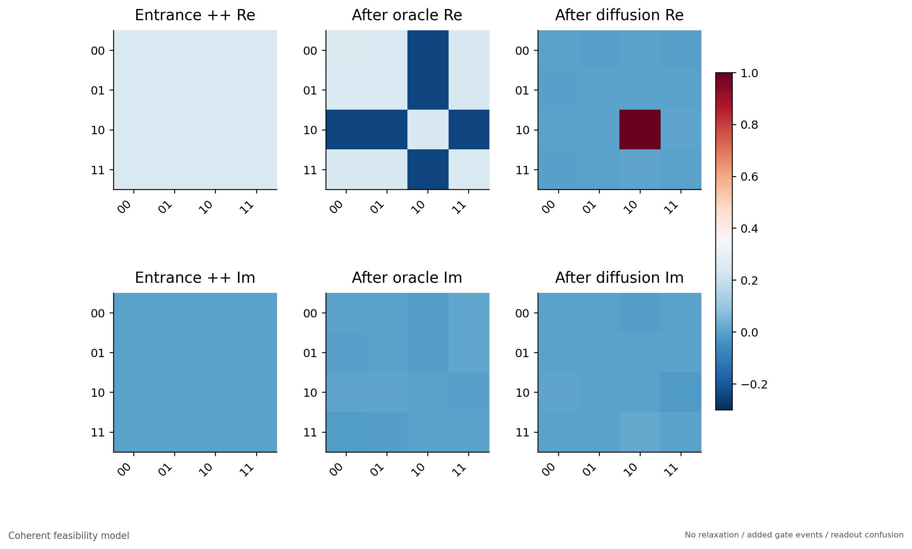

同一相干传播中的oracle与diffusion：前者主要改相干符号，后者把它变为目标人口。

## 11. 脉冲setup、虚拟相位与冻结校准值

### 11.1 参考器件与波形

以下来自合成参考器件与lab-equivalent模拟参数，**不是最新芯片校准**。标签只表示参考四位对应，尚不是17角色的硬件映射。

| 线 | 参考标签 | f01 / GHz | 非谐性 / GHz |
| --- | --- | --- | --- |
| C | q111 | 4.600000 | -0.220000 |
| I | q121 | 5.000000 | -0.220000 |
| L | q130 | 5.500000 | -0.220000 |
| R | q112 | 5.650000 | -0.235000 |

四能级、积分步长0.1 ns；另已做0.05 ns及五能级检查。局域每次只打开被选CZ边，其他边耦合为0。单门时耦合为0，异位单门可并行。

单门微波包络与DRAG采用

$$
s(t)=\frac{1-\cos(2\pi t/T)}{2},\qquad
\Omega(t)=A\left[s(t)-i\eta\frac{\dot s(t)}{\alpha}\right].
$$

这里A与α使用程序的GHz单位，η就是表中DRAG系数；这是本模拟器的约定。对应驱动Hamiltonian写作`π[Ω a†+Ω* a]`，不能把幅度直接当成未经单位换算的AWG电压。单门载频为`f01+δ`或`f01+α+δ`，φ决定横向轴。

CZ用同一平滑权重w(t)同时调频和打开耦合：起坡`w=[1−cos(πt/τ)]/2`，中间平台w=1，末坡时间反向。具体为

$$
f_q(t)=f_q^0+w(t)(f_q^{\rm CZ}-f_q^0),\quad
g_{ab}(t)=\rho_{ab}\sqrt{f_a(t)f_b(t)}\,w(t)\,p.
$$

当前三边ρ均0.0031，峰值因子p均1。其余边关闭。频率与耦合的真实仪器换算、脉冲失真和串扰尚未进入该参考设置。

| 线 | 门 | T / ns | A / MHz | δ / MHz | DRAG | 原生补偿(f01,f12) / rad |
| --- | --- | --- | --- | --- | --- | --- |
| C | X01/2 | 32.000 | 15.623205 | -0.190561 | 0.144406 | 0.038312, 0.012235 |
| C | X01 | 32.000 | 31.195108 | -1.076721 | 0.134111 | 0.216488, 0.017887 |
| C | X12 | 40.000 | 17.692091 | -0.538408 | 0.082153 | -0.168782, 0.135317 |
| I | X01/2 | 32.000 | 15.623236 | -0.190544 | 0.144409 | 0.038312, 0.012235 |
| I | X01 | 32.000 | 31.156308 | -1.373690 | 0.149271 | 0.276197, -0.012125 |
| I | X12 | 40.000 | 17.692086 | -0.538369 | 0.082149 | -0.168777, 0.135307 |
| L | X01/2 | 32.000 | 15.623216 | -0.190535 | 0.144403 | 0.038309, 0.012237 |
| L | X01 | 32.000 | 31.257109 | -0.507768 | 0.105243 | 0.102093, 0.075328 |
| L | X12 | 40.000 | 17.692085 | -0.538399 | 0.082151 | -0.168781, 0.135314 |
| R | X01/2 | 32.000 | 15.623367 | -0.180091 | 0.145040 | 0.036214, 0.011278 |
| R | X01 | 32.000 | 31.271875 | -0.296084 | 0.095514 | 0.059531, 0.088498 |
| R | X12 | 40.000 | 17.688586 | -0.545110 | 0.085622 | -0.163076, 0.137001 |

| CZ边 | 调谐线 | 调谐频率 / GHz | T / ns | 坡τ / ns | 两线原生补偿 / rad |
| --- | --- | --- | --- | --- | --- |
| C–I | I | 4.818937693 | 30.641834 | 5.725930 | 0.141549, 3.071237 |
| I–L | L | 5.244278591 | 56.371311 | 11.894511 | 0.261360, 2.086477 |
| I–R | R | 5.259764008 | 64.820457 | 16.500000 | 0.257549, -1.159932 |

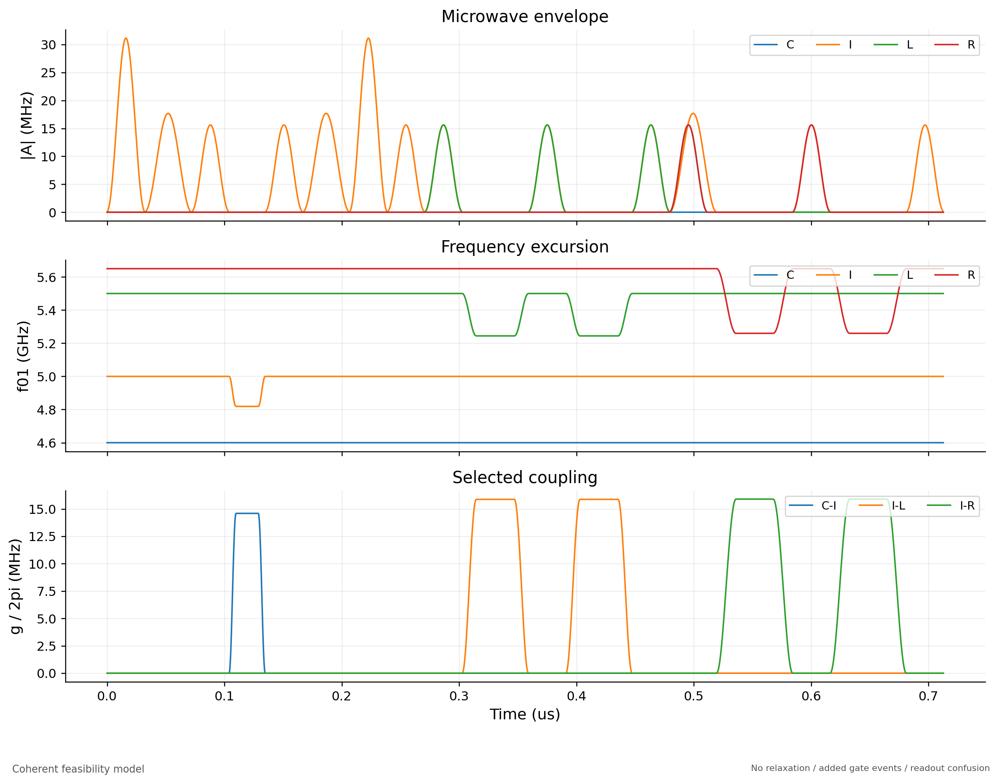

R5 down的冻结包络、频率及耦合设置；示意省略快速载波，相位由门表和帧缓冲管理。

### 11.2 虚拟Z在这里究竟调用什么

每条线维护两个软件缓冲`(f01,f12)`。程序的名义相位φ进入驱动时变为：01门用`φ+f01`，12门用`φ+f12`。

| 调用 | 缓冲更新 | 是否物理脉冲 |
| --- | --- | --- |
| frame(φ) | f01+=φ，f12+=φ | 否 |
| frame_01(φ) | 仅f01+=φ | 否 |
| frame_12(φ) | 仅f12+=φ | 否 |
| 单门原生补偿 | 按门库二元组分别加至f01、f12 | 否，随物理门自动累加 |
| CZ原生补偿 | 每条参与线的标量同时加至该线两个缓冲 | 否，随CZ自动累加 |

去掉已知空闲参考旋转后，帧定义的逻辑对角矩阵为

$$
F(f_{01},f_{12})=\operatorname{diag}
(1,e^{-if_{01}},e^{-i(f_{01}+f_{12})},e^{-i(f_{01}+2f_{12})}).
$$

因此普通`frame(φ)`在012空间对应`diag(1,e^−iφ,e^−i2φ)`，不等于独立指定两条能级相位。R5的V展开利用两跃迁缓冲来维持01块与辅助态的相对关系。

这些是参考系更新，不是瞬间给量子态施加一个额外物理Z脉冲。拼接模块时必须携带一致的逻辑参考帧；若使用已含原生补偿的编译器，不能重复再加一次表中补偿。硬件接口的符号与默认X12相位需用01/12 Ramsey确认。

### 11.3 上下行端点参数与R5的V

下表为本次传播引用的冻结JSON值；并非理想矩阵解。下行帧加在body之后，上行帧加在body之前。

| 方案 | 方向 | φc | φl | φr | 位置 |
| --- | --- | --- | --- | --- | --- |
| R5 | down | 2.136815 | -0.134507 | 2.348115 | 输出C/L/R |
| R5 | up | 2.159159 | -0.153203 | 2.334839 | 输入C/L/R |
| R6 | down | 2.139030 | -0.133450 | 2.956958 | 输出C/L/R |
| R6 | up | 2.114272 | -0.143818 | 3.006746 | 输入C/L/R |

R5 `down`所用矩阵（保留6位小数；计算使用JSON全精度）：

$$
V_{\rm down}=
\begin{pmatrix}
0.923048+0.000000i & -0.001145-0.384684i \\
0.274545-0.269459i & 0.648521+0.656839i
\end{pmatrix}.
$$

R5 `up`所用矩阵（保留6位小数；计算使用JSON全精度）：

$$
V_{\rm up}=
\begin{pmatrix}
0.922191+0.000000i & 0.273149-0.273776i \\
0.000251-0.386734i & 0.652412+0.651763i
\end{pmatrix}.
$$

原上行参数的校准元数据声明：相干校准针对匹配down准备的往返。当前报告另外计算独立合法入口up与实际往返，不能把原校准目标改称为独立up已全面优化。R6没有paired矩阵参数。

### 11.4 V怎样落到已有门集

程序先做`V=e^{iα}Rz(β)Ry(θ)Rz(γ)`分解。定义两跃迁帧组合

```text
Z̃(δ): F01(−δ) → F12(δ/2)
```

在012空间它等于`Rz(δ)⊕1`乘一个公共相位。随后按时间顺序调用

```text
Z̃(γ) → Z̃(π/2) → X01/2(+π/2)
→ Z̃(θ) → X01/2(−π/2)
→ Z̃(−π/2) → Z̃(β) → F12(α)
```

末尾F12(α)保留01块相对于辅助2态的相位关系；不能把V的01公共相位直接丢掉。这也说明V只需要两个半门与软件帧。V†以其矩阵重新执行相同分解，不是简单把每个名义轴符号翻转。第12节已经展开这些帧的实际数值，计算保留全精度。

## 12. 可逐门核对的四份局域序列

以下直接调用当前协议代码与上述参数JSON导出，不手抄门序列。`名义φ`是协议指令中的轴；`缓冲φ`是本地时间从0、帧从0开始，按原生补偿和前置帧累计后的驱动轴（折回`[−π,π]`，不含绝对载波振荡）。

`F/F01/F12`行是软件更新，时长0；同一个层号中的物理单门并行。每个层边界等价于barrier隔离，单门与CZ不会同层。表内的并行化保持相关门顺序，不跨过共享线或依赖关系随意重排。

拼接整树时不能把每个模块的“缓冲φ”生硬当作全局AWG相位；它需要与外部帧及绝对时钟转换一致。原始展开与未折回相位已保存在[机器可读门表](feasibility/native_operation_details.json)。完整整网层表在[R5附录](feasibility/native_layers_r5.md)与[R6附录](feasibility/native_layers_r6.md)。

### 12.1 R5 down

18个物理层；713.025368 ns。时间列为所在层的起点，某门短于同层最长门时需等待到层末。

| 指令 | 层 | 层起点 / ns | 门 | 线 | 名义φ / rad | 缓冲φ / rad | 门长 / ns |
| --- | --- | --- | --- | --- | --- | --- | --- |
| 1 | 1 | 0.000 | X01 | I | 0.000000 | 0.000000 | 32.000 |
| 2 | 2 | 32.000 | X12 | I | 0.000000 | -0.012125 | 40.000 |
| 3 | 3 | 72.000 | X01/2 | I | -1.570796 | -1.463377 | 32.000 |
| 4 | 4 | 104.000 | CZ | C,I | — | — | 30.642 |
| 5 | 5 | 134.642 | X01/2 | I | 1.570796 | -1.495421 | 32.000 |
| 6 | 6 | 166.642 | X12 | I | 0.000000 | -3.064297 | 40.000 |
| 7 | 7 | 206.642 | X01 | I | 0.000000 | 3.086503 | 32.000 |
| 8 | 7 | 206.642 | F01 | I | -1.567820 | — | 0.000 |
| 9 | 7 | 206.642 | F12 | I | 0.783910 | — | 0.000 |
| 10 | 7 | 206.642 | F01 | I | -1.570796 | — | 0.000 |
| 11 | 7 | 206.642 | F12 | I | 0.785398 | — | 0.000 |
| 12 | 8 | 238.642 | X01/2 | I | 1.570796 | 1.794880 | 32.000 |
| 13 | 8 | 238.642 | F01 | I | -0.789734 | — | 0.000 |
| 14 | 8 | 238.642 | F12 | I | 0.394867 | — | 0.000 |
| 15 | 9 | 270.642 | X01/2 | I | -1.570796 | -2.098135 | 32.000 |
| 16 | 9 | 270.642 | F01 | I | 1.570796 | — | 0.000 |
| 17 | 9 | 270.642 | F12 | I | -0.785398 | — | 0.000 |
| 18 | 9 | 270.642 | F01 | I | 0.776049 | — | 0.000 |
| 19 | 9 | 270.642 | F12 | I | -0.388025 | — | 0.000 |
| 20 | 9 | 270.642 | F12 | I | 0.395885 | — | 0.000 |
| 21 | 9 | 270.642 | X01/2 | L | -1.570796 | -1.570796 | 32.000 |
| 22 | 10 | 302.642 | CZ | I,L | — | — | 56.371 |
| 23 | 11 | 359.013 | X01/2 | L | 1.570796 | -2.587603 | 32.000 |
| 24 | 11 | 359.013 | X01/2 | I | -1.570796 | 0.548383 | 32.000 |
| 25 | 12 | 391.013 | CZ | L,I | — | — | 56.371 |
| 26 | 13 | 447.384 | X01/2 | I | 1.570796 | -2.293538 | 32.000 |
| 27 | 13 | 447.384 | F01 | L | 2.365544 | — | 0.000 |
| 28 | 13 | 447.384 | F12 | L | -1.182772 | — | 0.000 |
| 29 | 13 | 447.384 | F01 | L | -1.570796 | — | 0.000 |
| 30 | 13 | 447.384 | F12 | L | 0.785398 | — | 0.000 |
| 31 | 13 | 447.384 | X01/2 | L | 1.570796 | 0.331930 | 32.000 |
| 32 | 13 | 447.384 | F01 | L | -0.789734 | — | 0.000 |
| 33 | 13 | 447.384 | F12 | L | 0.394867 | — | 0.000 |
| 34 | 14 | 479.384 | X01/2 | L | -1.570796 | 2.722098 | 32.000 |
| 35 | 14 | 479.384 | F01 | L | 1.570796 | — | 0.000 |
| 36 | 14 | 479.384 | F12 | L | -0.785398 | — | 0.000 |
| 37 | 14 | 479.384 | F01 | L | -1.573773 | — | 0.000 |
| 38 | 14 | 479.384 | F12 | L | 0.786886 | — | 0.000 |
| 39 | 14 | 479.384 | F12 | L | -0.395885 | — | 0.000 |
| 40 | 14 | 479.384 | X12 | I | 0.000000 | -1.182817 | 40.000 |
| 41 | 14 | 479.384 | X01/2 | R | -1.570796 | -1.570796 | 32.000 |
| 42 | 15 | 519.384 | CZ | I,R | — | — | 64.820 |
| 43 | 16 | 584.205 | X01/2 | R | 1.570796 | 0.447078 | 32.000 |
| 44 | 16 | 584.205 | X01/2 | I | -1.570796 | 0.975138 | 32.000 |
| 45 | 17 | 616.205 | CZ | R,I | — | — | 64.820 |
| 46 | 18 | 681.025 | X01/2 | I | 1.570796 | -1.870594 | 32.000 |
| 47 | 18 | 681.025 | F | C | 2.136815 | — | 0.000 |
| 48 | 18 | 681.025 | F | L | -0.134507 | — | 0.000 |
| 49 | 18 | 681.025 | F | R | 2.348115 | — | 0.000 |

### 12.2 R5 up

18个物理层；713.025368 ns。时间列为所在层的起点，某门短于同层最长门时需等待到层末。

| 指令 | 层 | 层起点 / ns | 门 | 线 | 名义φ / rad | 缓冲φ / rad | 门长 / ns |
| --- | --- | --- | --- | --- | --- | --- | --- |
| 1 | 1 | 0.000 | F | C | 2.159159 | — | 0.000 |
| 2 | 1 | 0.000 | F | L | -0.153203 | — | 0.000 |
| 3 | 1 | 0.000 | F | R | 2.334839 | — | 0.000 |
| 4 | 1 | 0.000 | X01/2 | I | -1.570796 | -1.570796 | 32.000 |
| 5 | 2 | 32.000 | CZ | R,I | — | — | 64.820 |
| 6 | 3 | 96.820 | X01/2 | I | 1.570796 | 1.866657 | 32.000 |
| 7 | 3 | 96.820 | X01/2 | R | -1.570796 | -0.395889 | 32.000 |
| 8 | 4 | 128.820 | CZ | I,R | — | — | 64.820 |
| 9 | 5 | 193.641 | X01/2 | R | 1.570796 | 1.621986 | 32.000 |
| 10 | 5 | 193.641 | X12 | I | 0.000000 | 0.539567 | 40.000 |
| 11 | 5 | 193.641 | F01 | L | 1.571444 | — | 0.000 |
| 12 | 5 | 193.641 | F12 | L | -0.785722 | — | 0.000 |
| 13 | 5 | 193.641 | F01 | L | -1.570796 | — | 0.000 |
| 14 | 5 | 193.641 | F12 | L | 0.785398 | — | 0.000 |
| 15 | 5 | 193.641 | X01/2 | L | 1.570796 | 1.418242 | 32.000 |
| 16 | 5 | 193.641 | F01 | L | -0.794176 | — | 0.000 |
| 17 | 5 | 193.641 | F12 | L | 0.397088 | — | 0.000 |
| 18 | 6 | 233.641 | X01/2 | L | -1.570796 | -2.479218 | 32.000 |
| 19 | 6 | 233.641 | F01 | L | 1.570796 | — | 0.000 |
| 20 | 6 | 233.641 | F12 | L | -0.785398 | — | 0.000 |
| 21 | 6 | 233.641 | F01 | L | -0.786544 | — | 0.000 |
| 22 | 6 | 233.641 | F12 | L | 0.393272 | — | 0.000 |
| 23 | 6 | 233.641 | F12 | L | -0.392450 | — | 0.000 |
| 24 | 6 | 233.641 | X01/2 | I | -1.570796 | -1.147853 | 32.000 |
| 25 | 7 | 265.641 | CZ | L,I | — | — | 56.371 |
| 26 | 8 | 322.012 | X01/2 | I | 1.570796 | 2.293412 | 32.000 |
| 27 | 8 | 322.012 | X01/2 | L | -1.570796 | 0.429820 | 32.000 |
| 28 | 9 | 354.012 | CZ | I,L | — | — | 56.371 |
| 29 | 10 | 410.384 | X01/2 | L | 1.570796 | -0.586987 | 32.000 |
| 30 | 10 | 410.384 | F01 | I | -2.355049 | — | 0.000 |
| 31 | 10 | 410.384 | F12 | I | 1.177524 | — | 0.000 |
| 32 | 10 | 410.384 | F01 | I | -1.570796 | — | 0.000 |
| 33 | 10 | 410.384 | F12 | I | 0.785398 | — | 0.000 |
| 34 | 10 | 410.384 | X01/2 | I | 1.570796 | -1.332761 | 32.000 |
| 35 | 10 | 410.384 | F01 | I | -0.794176 | — | 0.000 |
| 36 | 10 | 410.384 | F12 | I | 0.397088 | — | 0.000 |
| 37 | 11 | 442.384 | X01/2 | I | -1.570796 | 1.052968 | 32.000 |
| 38 | 11 | 442.384 | F01 | I | 1.570796 | — | 0.000 |
| 39 | 11 | 442.384 | F12 | I | -0.785398 | — | 0.000 |
| 40 | 11 | 442.384 | F01 | I | 1.570148 | — | 0.000 |
| 41 | 11 | 442.384 | F12 | I | -0.785074 | — | 0.000 |
| 42 | 11 | 442.384 | F12 | I | 0.392450 | — | 0.000 |
| 43 | 12 | 474.384 | X01 | I | 0.000000 | -0.480165 | 32.000 |
| 44 | 13 | 506.384 | X12 | I | 0.000000 | 2.416398 | 40.000 |
| 45 | 14 | 546.384 | X01/2 | I | -1.570796 | -1.943542 | 32.000 |
| 46 | 15 | 578.384 | CZ | C,I | — | — | 30.642 |
| 47 | 16 | 609.025 | X01/2 | I | 1.570796 | -1.975586 | 32.000 |
| 48 | 17 | 641.025 | X12 | I | 0.000000 | -0.635773 | 40.000 |
| 49 | 18 | 681.025 | X01 | I | 0.000000 | 2.606338 | 32.000 |

### 12.3 R6 down

19个物理层；769.396679 ns。时间列为所在层的起点，某门短于同层最长门时需等待到层末。

| 指令 | 层 | 层起点 / ns | 门 | 线 | 名义φ / rad | 缓冲φ / rad | 门长 / ns |
| --- | --- | --- | --- | --- | --- | --- | --- |
| 1 | 1 | 0.000 | X01/2 | L | -1.570796 | -1.570796 | 32.000 |
| 2 | 2 | 32.000 | CZ | I,L | — | — | 56.371 |
| 3 | 3 | 88.371 | X01/2 | L | 1.570796 | -2.587603 | 32.000 |
| 4 | 3 | 88.371 | X01 | I | 0.000000 | 0.261360 | 32.000 |
| 5 | 4 | 120.371 | X12 | I | 0.000000 | 0.249235 | 40.000 |
| 6 | 5 | 160.371 | X01/2 | I | -1.570796 | -1.202017 | 32.000 |
| 7 | 6 | 192.371 | CZ | C,I | — | — | 30.642 |
| 8 | 7 | 223.013 | X01/2 | I | 1.570796 | -1.234061 | 32.000 |
| 9 | 8 | 255.013 | X12 | I | 0.000000 | -2.802937 | 40.000 |
| 10 | 9 | 295.013 | X01 | I | 0.000000 | -2.935323 | 32.000 |
| 11 | 10 | 327.013 | X01/2 | I | -1.570796 | 2.053263 | 32.000 |
| 12 | 11 | 359.013 | CZ | L,I | — | — | 56.371 |
| 13 | 12 | 415.384 | X01/2 | I | 1.570796 | -0.788657 | 32.000 |
| 14 | 13 | 447.384 | X12 | I | 0.000000 | -2.393924 | 40.000 |
| 15 | 13 | 447.384 | X01/2 | L | -1.570796 | 2.678775 | 32.000 |
| 16 | 14 | 487.384 | CZ | I,L | — | — | 56.371 |
| 17 | 15 | 543.756 | X01/2 | L | 1.570796 | 1.661969 | 32.000 |
| 18 | 15 | 543.756 | X01/2 | R | -1.570796 | -1.570796 | 32.000 |
| 19 | 16 | 575.756 | CZ | I,R | — | — | 64.820 |
| 20 | 17 | 640.576 | X01/2 | R | 1.570796 | 0.447078 | 32.000 |
| 21 | 17 | 640.576 | X01/2 | I | -1.570796 | 2.741379 | 32.000 |
| 22 | 18 | 672.576 | CZ | R,I | — | — | 64.820 |
| 23 | 19 | 737.397 | X01/2 | I | 1.570796 | -0.104354 | 32.000 |
| 24 | 19 | 737.397 | F | C | 2.139030 | — | 0.000 |
| 25 | 19 | 737.397 | F | L | -0.133450 | — | 0.000 |
| 26 | 19 | 737.397 | F | R | 2.956958 | — | 0.000 |

### 12.4 R6 up

19个物理层；769.396679 ns。时间列为所在层的起点，某门短于同层最长门时需等待到层末。

| 指令 | 层 | 层起点 / ns | 门 | 线 | 名义φ / rad | 缓冲φ / rad | 门长 / ns |
| --- | --- | --- | --- | --- | --- | --- | --- |
| 1 | 1 | 0.000 | F | C | 2.114272 | — | 0.000 |
| 2 | 1 | 0.000 | F | L | -0.143818 | — | 0.000 |
| 3 | 1 | 0.000 | F | R | 3.006746 | — | 0.000 |
| 4 | 1 | 0.000 | X01/2 | I | -1.570796 | -1.570796 | 32.000 |
| 5 | 2 | 32.000 | CZ | R,I | — | — | 64.820 |
| 6 | 3 | 96.820 | X01/2 | I | 1.570796 | 1.866657 | 32.000 |
| 7 | 3 | 96.820 | X01/2 | R | -1.570796 | 0.276017 | 32.000 |
| 8 | 4 | 128.820 | CZ | I,R | — | — | 64.820 |
| 9 | 5 | 193.641 | X01/2 | R | 1.570796 | 2.293892 | 32.000 |
| 10 | 5 | 193.641 | X01/2 | L | -1.570796 | -1.714614 | 32.000 |
| 11 | 6 | 225.641 | CZ | I,L | — | — | 56.371 |
| 12 | 7 | 282.012 | X01/2 | L | 1.570796 | -2.731421 | 32.000 |
| 13 | 7 | 282.012 | X12 | I | 0.000000 | 0.800927 | 40.000 |
| 14 | 8 | 322.012 | X01/2 | I | -1.570796 | -0.886493 | 32.000 |
| 15 | 9 | 354.012 | CZ | L,I | — | — | 56.371 |
| 16 | 10 | 410.384 | X01/2 | I | 1.570796 | 2.554772 | 32.000 |
| 17 | 11 | 442.384 | X01 | I | 0.000000 | 1.022288 | 32.000 |
| 18 | 12 | 474.384 | X12 | I | 0.000000 | 1.209940 | 40.000 |
| 19 | 13 | 514.384 | X01/2 | I | -1.570796 | -0.441089 | 32.000 |
| 20 | 14 | 546.384 | CZ | C,I | — | — | 30.642 |
| 21 | 15 | 577.025 | X01/2 | I | 1.570796 | -0.473133 | 32.000 |
| 22 | 16 | 609.025 | X12 | I | 0.000000 | -1.842232 | 40.000 |
| 23 | 17 | 649.025 | X01 | I | 0.000000 | -2.174395 | 32.000 |
| 24 | 17 | 649.025 | X01/2 | L | -1.570796 | 2.534958 | 32.000 |
| 25 | 18 | 681.025 | CZ | I,L | — | — | 56.371 |
| 26 | 19 | 737.397 | X01/2 | L | 1.570796 | 1.518151 | 32.000 |

## 13. 仿真到底验证到了哪一步

下面使用已有保存数据，不因导出Markdown而重新优化门。

理想原生构造覆盖R5/R6各16种数据库，完整8×8查询矩阵去掉公共全局相位后的最大元素误差为`8.48e-15`。所有理想四目标Grover成功率为1，临时树返回全0。原生理想端点帧解保存在[checks.json](feasibility/checks.json)。

| 方案/路径 | 16态平均原始重叠 | 四维合法入口过程Fe | 01生存率 |
| --- | --- | --- | --- |
| r5_down | 99.6244% | 99.5699% | 99.5732% |
| r5_up | 99.5742% | 99.5596% | 99.5729% |
| r5_roundtrip | 99.3226% | 99.3102% | 99.3282% |
| r6_down | 99.6068% | 99.5516% | 99.5706% |
| r6_up | 99.5682% | 99.5560% | 99.5702% |
| r6_roundtrip | 99.4441% | 99.4171% | 99.4515% |

16态是C、I各取`0,1,+,−`。down的态重叠在CLR输出上评估；up及roundtrip在CI返回上评估；表中的合法入口Fe使用完整四线过程，检查所有相对相位，和迹掉某线的态重叠不是同一个指标。

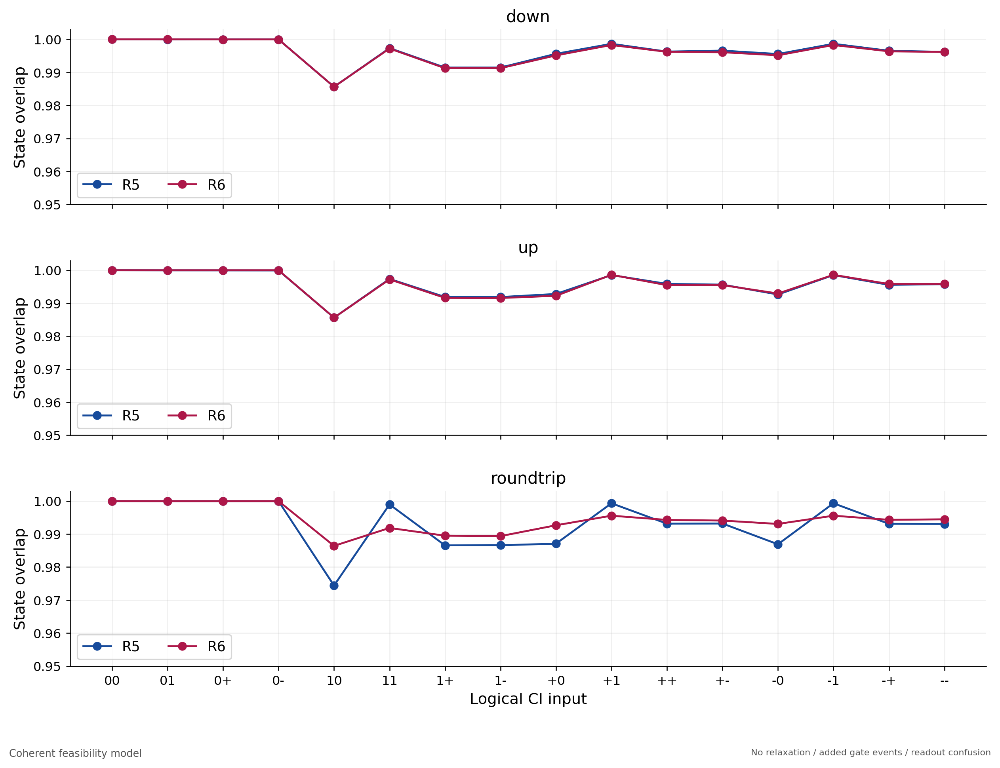

16初态逐一比较down、独立合法入口up和实际down→up。相同人口不能替代相干态检查。

R5固定其他参数移除配对V后，`CI=11`目标四线人口为84.8445%，有配对为99.7340%。移除后未重新优化其他参数，只证明当前配对补偿的作用。

| 方案 | 16数据库平均原始query Fe | 四目标平均原始Grover成功率 | 平均辅助0概率（Choi） |
| --- | --- | --- | --- |
| R5 | 97.9840% | 98.9007% | 98.0320% |
| R6 | 98.3080% | 98.7237% | 98.4491% |

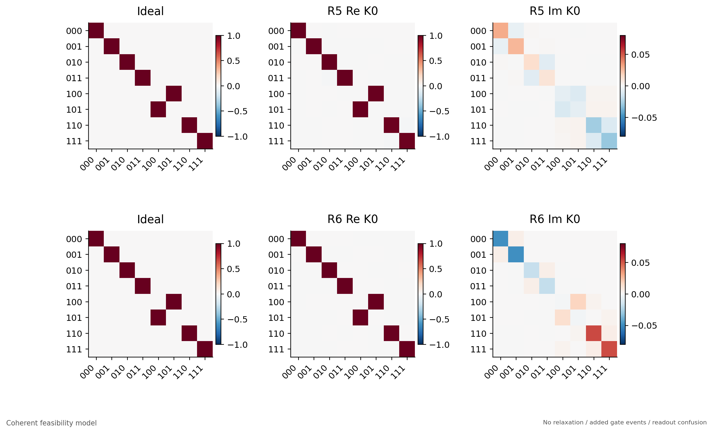

M=0010的8×8含相位K0：行输出、列输入，只投影真实辅助全0，不按列归一。

K0是完整传播U在临时辅助零分支上的矩阵：`K0=<0_aux|U|0_aux>`。通常`K0†K0≠I`，因为还有其他辅助末态分支。完整查询应看迹掉辅助后的通道，而不是把K0每列归一化后宣布酉门成功。

若ρ是实际输出，理想目标为纯态ψ，原始态重叠是`F=<ψ|ρ|ψ>`；若P0投影辅助全0，则接受率`p0=Tr(P0ρ)`，条件结果由`P0ρP0/p0`计算。条件成功率、接受率、联合正确比例必须分列，不能只报条件高数值。

完整三输入query的归一化Choi态为`J=(I⊗E)(|Φ8><Φ8|)`，`|Φ8>=Σx|x,x>/√8`；相对目标U的过程重叠`Fe=<ΦU|J|ΦU>`。原始Fe检查所有复数输入关系，人口真值表只检查基态转移。局域Fe则把输入维数8换为合法四维入口。

所有这些图都是直接相干传播的数据，不是带有限shots的实验QST重建。模块外01延拓还限制了外部AD泄露，不能据此判断真实系统没有泄露。

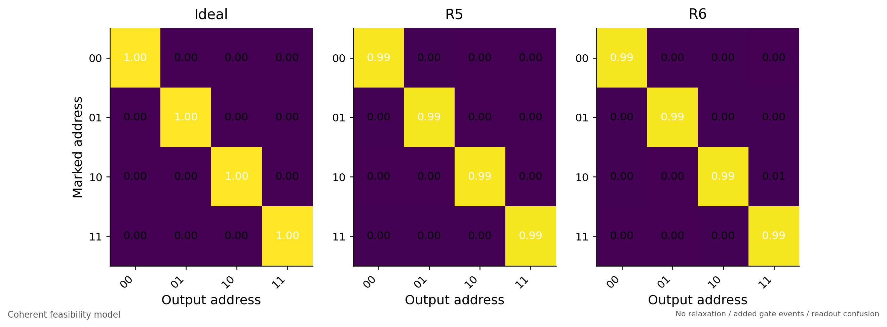

四个one-hot数据库的一轮Grover原始成功人口；同一线路只更换存储初态。

## 14. 资源消耗：逐层计数，不把宏当免费门

两层四存储的一轮Grover口径如下；包含query和一次扩散，不含实际入口制备、读出和复位。

| 量 | R5 | R6 |
| --- | --- | --- |
| router调用 | 8 | 8 |
| router内部CZ | 40 | 48 |
| CZ层深 | 86 | 92 |
| 总调度层数（含入口等待） | 283 | 289 |
| query时长 / ns | 11184.152 | 11522.380 |
| 含扩散总时长 / ns | 11426.152 | 11764.380 |

| 计数 | R5 | R6 |
| --- | --- | --- |
| CZ总数 | 105 | 113 |
| 其中跨片CZ | 18 | 18 |
| 物理单门 | 288 | 272 |

计数可拆为`8×(5或6)+65=105或113`。额外65个CZ来自：树控制保存/取出完整SWAP 18、跨片完整SWAP 18、QPU中转完整SWAP 24、固定存储CZ 4、扩散CZ 1。跨片CZ已经包括在总数中，不应再加一遍。

当前完整SWAP共20个，贡献60个CZ、120个半门；query之外的diffusion只有1个CZ。6次H门调用全部按两个脉冲展开；地址上并行的两次H仍计为两个门调用，但共享两层时钟。

单门可在不相交的线上并行；CZ也可在不相交边并行；任何物理单门不能与CZ同层。虚拟帧没有物理脉冲时长。参考调度未额外插入回波CZ或动态解耦XX，也未做全局最深度优化；这里没有声称已经证明最少门数。

扩展到n层、N=2^n个存储位，本串行地址注入协议的工作角色数为`4N+n−1`，router调用数为`4N−2n−4`。n=1、2、3分别为8/17/34位和2/8/22次调用。n=2资源包含一次diffusion，其他规模只计query，跨规模比较时必须统一口径。

完整执行细节：[R5逐层表](feasibility/native_layers_r5.md)、[R6逐层表](feasibility/native_layers_r6.md)。两表列出每一层的起止时间、阶段、线路角色和算子来源指纹。

## 15. 如何核对、复现与继续做实验

### 15.1 更新本文不会重新跑物理实验

在本机PowerShell中执行：

```powershell
Set-Location "C:\Users\qt_super\Documents\ChatGPT\TCG"
& "C:\Users\qt_super\.conda\envs\SQEM_code\python.exe" "Experiment\DistributedGroverNoDecoherence20261102\circuit_details.py"
```

该命令读取协议、冻结参数、已保存的结果和完整调度，重新导出本文、四方向机器可读门表、整网逐层Markdown附录，并刷新已有报告的Markdown入口。它不下发硬件、不优化脉冲、不重跑整网传播、不修改已有PDF。完整数值传播和报告重建命令见[README](README.md)。

本研究依赖同一Experiment目录中的协议、脉冲校准和模拟内核；不是只复制本目录到空电脑就能直接独立运行的软件包。

### 15.2 数据与代码入口

| 内容 | 入口 |
| --- | --- |
| 下上行逻辑、CNOT和V展开调用 | [protocol.py](../LabRouterR5R6/router_r5_r6/protocol.py) |
| V到半门/两跃迁帧的展开 | [single_01_unitary所在协议](../LabPartialCSWAPVZ4/partial_cswap_vz4/protocol.py) |
| 单门/CZ分层及barrier | [timing_plan.py](../LabPartialCSWAPVZ4/partial_cswap_vz4/timing_plan.py) |
| 脉冲与相位缓冲 | [pulse_model.py](../RouterPulseCalibration20261002/pulse_model.py) |
| 冻结原生校准 | [native_parameters.json](../RouterPulseCalibration20261002/results/native/native_parameters.json) |
| 整树动作及外部门延拓 | [circuit.py](../DistributedGroverSimulation20261102/circuit.py)、[model.py](../DistributedGroverSimulation20261102/model.py) |
| H展开与无附加错误传播 | [feasibility_data.py](feasibility_data.py) |
| 理想原生矩阵验证 | [feasibility_checks.py](feasibility_checks.py)、[checks.json](feasibility/checks.json) |
| 局域原始结果 | [local.json](feasibility/local.json)、[local.npz](feasibility/local.npz) |
| 整机逐数据库结果 | [SUMMARY.json](feasibility/SUMMARY.json)、[cases目录](feasibility/cases) |
| 资源 | [resources.json](feasibility/resources.json) |
| 所有局域名义/缓冲门相位 | [native_operation_details.json](feasibility/native_operation_details.json) |
| 输入文件指纹与文档核对 | [circuit_details_manifest.json](feasibility/circuit_details_manifest.json) |

四组参数文件分别为：

- [R5 down](../RouterPulseCalibration20261002/results/lab_equivalent_runs/r5/down/pulse-L4-shots1000/parameters.json)
- [R5 up](../RouterPulseCalibration20261002/results/lab_equivalent_runs/r5/up/pulse-L4-shots1000/parameters.json)
- [R6 down](../RouterPulseCalibration20261002/results/lab_equivalent_runs/r6/down/pulse-L4-shots1000/parameters.json)
- [R6 up](../RouterPulseCalibration20261002/results/lab_equivalent_runs/r6/up/pulse-L4-shots1000/parameters.json)

### 15.3 从线路可行到真机可行的衔接

首先给17个角色指定真实比特和coupler，按节点实际频率校准共享端口；再补齐QPU搬运、跨片CZ、存储CZ和入口制备的真实脉冲。全局帧必须贯穿地址加载、路由、存储访问和卸载。

然后按“原生门→含2态的搬运块→单节点down/up/往返→空query与路径Ramsey→固定数据库query→Grover”验证。人口不回零优先检查泄露、交换路径及实际上行；人口正确而叠加态失败时，再检查局域/非局域相位。不能用末端Z替代对人口错误的修复。

当前可行性结论来自理想门的完整功能检查及参考局域脉冲的过程组合。下一步应在相同字序、帧约定和分层规则下替换为真实门库，再评估实验性能。
