# QRAM与分布式Grover：线路可行性与相干脉冲验证

> 只研究理想原生门与相干脉冲过程；不附加耗散、随机门事件、准备/读出错误或有限shots重建。

完整门序列、相位约定、冻结参数及QRAM查询步骤见[线路细节与可行性说明](../CIRCUIT_DETAILS.md)。完整逐层调度：[R5](../feasibility/native_layers_r5.md)、[R6](../feasibility/native_layers_r6.md)。

## 结论先行：线路在规定输入域内成立

本版只研究线路可行性：允许的门是否足够，部分router每次调用是否满足输入约束，固定QRAM查询是否读对且保留相位，临时树是否恢复，以及能否闭合一轮Grover。全部弛豫、退相干、附加随机门事件、准备翻转、读出混淆和有限shots重建误差均不参与主结果。

理想原生门层面，已将R5/R6展开到CZ、X01、X12、任意轴X01/2和虚拟参考帧。两方案全部16数据库的8×8查询矩阵均正确，去除公共全局相位后的最大振幅误差约8.5e-15，四目标理想Grover均为100%。这不是把router当作不展开的黑箱后得到的检查。

冻结局域脉冲导出的整机过程基线中，R5/R6四目标平均原始Grover成功率为98.90% / 98.72%，16数据库平均完整查询Fe为97.98% / 98.31%。条件分支指标只作诊断，结论以不后选择的结果为主。

由此支持“线路结构与受限输入下的组合方案可行”。完整真机实现仍有前提：每个节点及共享端口的物理频率、接口门、跨片门和全局帧必须在真实拓扑中成立。当前没有连续求解一套共享参数的17体Hamiltonian，不能把这些基线百分数当成真机保证。

| 证据层次 | 本版结果 | 结论边界 |
| --- | --- | --- |
| 原生门矩阵 | 32项完整query精确通过 | 证明规定输入域的逻辑功能 |
| 局域四能级脉冲 | down/up/往返/相位与泄露 | 证明参考节点可近似实现 |
| 完整模块过程 | query、GHZ、Grover及辅助回零 | 证明过程可组合的参考基线 |
| 真实17位系统 | 尚无完整共享器件与接口门库 | 物理落地仍需独立验证 |

## 1. 这次只问线路是否成立

可行性首先是功能问题。输入满足约束时，输出是否是所需的线性变换；所有叠加分量的相对相位是否正确；下一次调用所需的真空端口是否恢复。人口真值表、态重叠、操作矩阵和过程Fe分别检查这些不同侧面。

因此本版不再用预设每门错误率推算系统成功率，也不使用读出误判、寿命损失或采样重建来压低主结果。已有物理脉冲的非理想旋转、条件相位和相干泄露仍然保留，由Hamiltonian传播自然产生。

后面的“状态矩阵”全部直接从相干传播获得，是实验QST要逼近的参照，不是假装已经测量重建。辅助全0始终指实际能级投影，没有二值标签误收/误拒的概念。

| 保留 | 关闭 |
| --- | --- |
| 四能级波形、失谐、DRAG、CZ频率与耦合轨迹 | T1弛豫与时间退相干 |
| 实际同CZ的down/up组合、配对旋转、虚拟帧 | 人为附加的随机Pauli与准备翻转 |
| 高能级、错误计算态、辅助残留 | 读出混淆及有限shots估计 |
| 不后选择的完整过程比较 | 用条件结果替代原始性能 |

## 2. 17个角色与线路所需的连边

QPU是A0、A1、D；树有三个控制C0/C1/C2，七个数据端口T0/T1/T2/L00/L01/L10/L11，四个M保存数据库。临时端口L与存储M是不同角色，不应混为一组。

参考拓扑仅有D-T0一条跨片网关；QPU还需A0-D、A1-D和A0-A1边。数值上演化13个四能级量子站点，四个M始终为基态条件变量；这是经典数据库下对固定CZ的精确收缩，不是任意量子存储输入的模拟。树根与子节点共享端口，校准不能彼此孤立。

单节点统一顺序C,I,L,R，C=0走左、C=1走右。全局矩阵用A0,A1,D，数据库字符串用M00,M01,M10,M11。此前若写C,I,R,L，比较矩阵前必须交换两端索引。

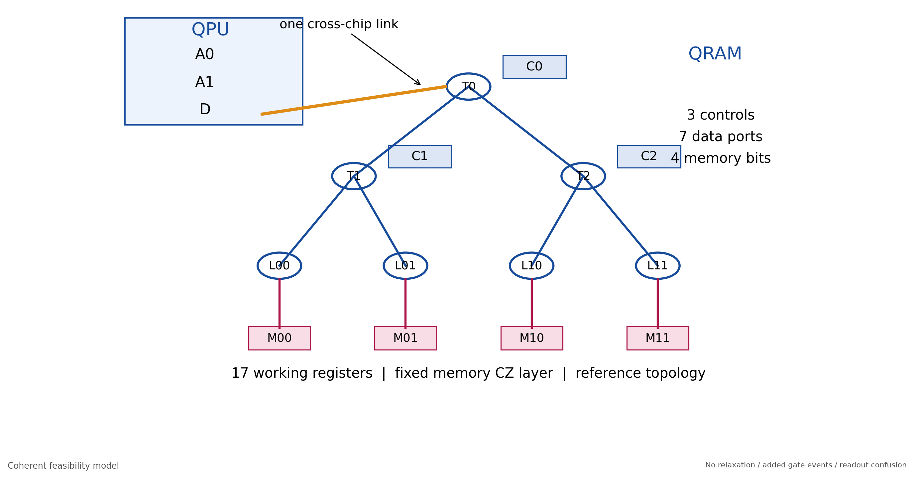
17个工作寄存器的角色和参考连边。橙色只代表一条D-T0跨片链路；叶端四条红线分别对应固定CZ(Lj,Mj)，数据库变化仅改变M的制备。QPU还假定D-A0、D-A1和A0-A1可直接操作。

## 3. 所有门都要展开到允许的门集

一个CNOT由目标-Y/2、CZ、目标+Y/2组成。Y/2就是相位+pi/2的X01/2，-Y/2为相位-pi/2；X使用原生X01。完整SWAP由三次CNOT组成，只指两位01空间，不声称交换任意qutrit态，也不要求平台提供原生CNOT或SWAP。

接口原先用H记号的地方，本版已实际展开为Y/2后接X。它在01空间等于-iH，共同全局相位不影响本任务。所有完整线路已用该展开重新传播与计数，不把H作为额外免费原生门。

两条跃迁参考帧用于单门轴与qutrit相位管理。理想矩阵层用其等效逻辑对角作用；局域脉冲层沿用相位缓冲改变后续载波，二者不可在实现上混淆。图上的X/2类型不意味着轴相位全部为0。

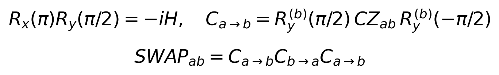

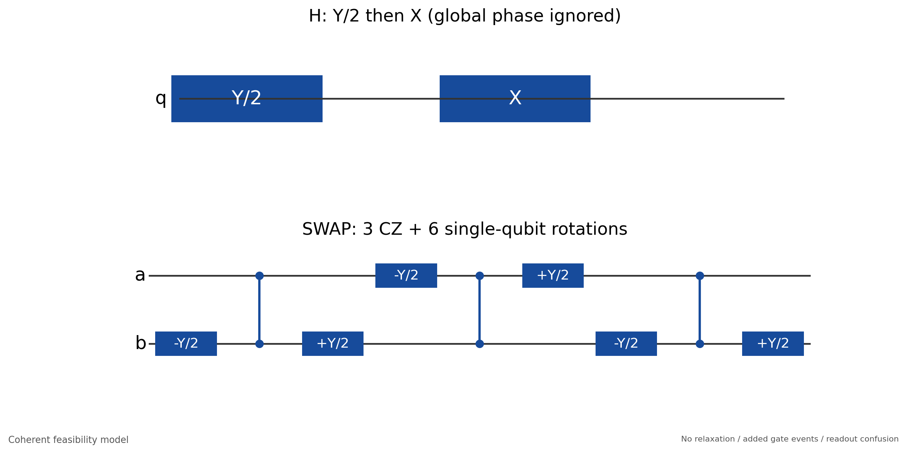
时间从左到右。Y/2为相位+pi/2的X01/2，-Y/2为相位-pi/2；X为原生X01，不拆成两个半门。H用Y/2→X，与理想H只差全局相位。下图展开完整SWAP，三次CZ均与单门层隔离，没有隐含CNOT原生门。

## 4. 部分router的输入条件必须一直成立

down只要求在|c,i,0,0>入口实现所示映射，不要求它对所有四位未知态都等于一个通用SWAP网络。两个输出端从真空开始，控制与输入可为任意相干叠加。

up则应在down的合法像空间上返回|c,i,0,0>。不能只在基态上对回去，还必须恢复四个基分量间的相位。实际脉冲down输出可能略偏离理想像空间，因此本版还直接计算真实down接真实up的往返。

理想17位协议检查128个(a,d,m)组合、256个H编码分支，共核对2048次调用的合法入口。每次down端口为空、up进入合法像空间，最后临时树恢复。这个输入域证明是把部分router用于QRAM的关键。

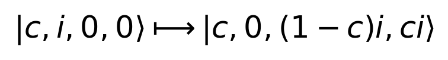

## 5. 固定存储访问为何给出正确query

W先保存地址，再路由数据。地址a分支只有对应叶端可能带数据激发，满足n[Lj]=d乘以delta(j,a)。执行全部四个固定CZ(Lj,Mj)后，该分支相位为(-1)的d*m[a]次方。

相干返回后临时树应清零，数据前后各放H将相位读取变为异或读取。D=0得到m[a]；D=->得到地址标记(-1)^m[a]。这两种任务来自同一query，而不是分别编译两种目标门。

改变数据库只改变M的制备，固定主体不接收目标地址。模拟器在M为基态时可把CZ条件作用收缩为叶端Z或恒等，这是数学计算简化；实际门计划中的四个存储CZ没有删除，始终执行和计数。

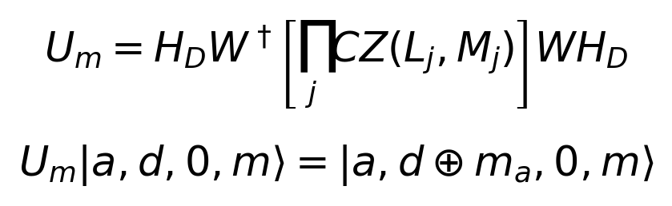

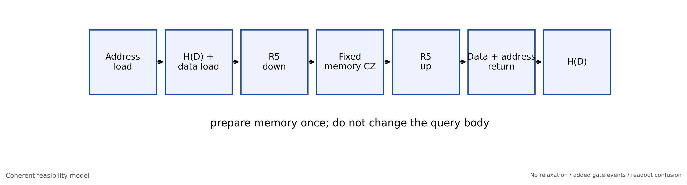
一次查询的完整流程。地址加载和数据路由属于W；回程使用实际标定的up，而不是数值强行取down的共轭转置。逻辑W逆关系需要用空查询、叠加态和辅助清零共同检验。

## 6. 理想原生矩阵验证：没有黑箱router

理想阶段逐个相乘CZ、01/12旋转与参考帧矩阵。保留pi脉冲自身的-i相位，不把X01、X12粗略当成没有相位的交换。由四个合法振幅解析求出三个端点参考帧，就可对齐合法输入的相对相位。

再将这些展开后的节点放入完整QRAM，R5/R6各16种数据库的8×8查询矩阵均与理想异或查询相同，最大误差8.5e-15，辅助全0概率为1（浮点精度内）。对四个one-hot数据库接同一扩散门，成功率全部为1。

理想CZ在高能级采用单位旁路延拓，此时配对V可取恒等。这个阶段证明原生结构有正确解，不把理想端点角度直接当作真实CZ的校准值；真实条件B块仍由下一层波形与冻结配对参数处理。

| 方案/方向 | CZ数 | 解析端点帧(c,l,r)，rad | 最大合法块误差 |
| --- | --- | --- | --- |
| r5_down | 5 | 0.0000, -3.1416, 1.5708 | 3.2e-16 |
| r5_up | 5 | 0.0000, -3.1416, 1.5708 | 3.2e-16 |
| r6_down | 6 | 0.0000, -3.1416, 1.5708 | 6.7e-16 |
| r6_up | 6 | 0.0000, -3.1416, 1.5708 | 4.5e-16 |

## 7. R5的五CZ原生线路

两行连续阅读，第二行承接第一行，不重新制备。蓝块是01旋转，红块是12旋转，连线双点是CZ。各单门已经排到并行列；CZ列与单门列隔离。

R5在编码重排后，把需要送右端的分支暂存在I的2态；左侧两CNOT转移区间再用前置V与后置逆V匹配辅助旁路。它没有增加额外两比特门，代价是更多可标定的单门和参考帧。

本图使用已有冻结物理参数，实际轴相位包含在源操作表中。不能把蓝块全部改成相位0，也不能在模块边界重置帧缓存，否则不再是这里验证的线路。

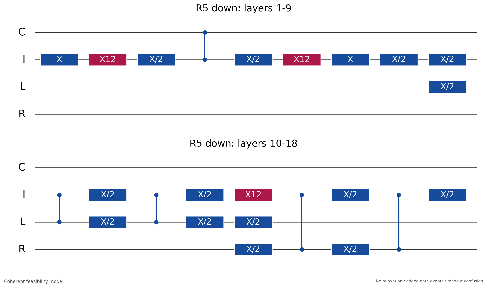
分上下两行连续阅读，第二行承接第一行末态，没有重置。每一列是可并行操作，CZ列和单门列隔离。X/X/2/X12只标旋转类型，实际轴相位、配对旋转和虚拟帧包含在冻结参数及矩阵中；这不是把全部驱动轴都设为X。四线顺序C,I,L,R。

## 8. R6的六CZ原生线路

R6采用不同的编码与搬运序列，不需要R5的配对V标定。两种方案具有相同受限入口与输出功能，便于比较构造和组合可行性。

多一个CZ不必然导致每个相干指标都更差。本版局域16态和完整查询均重新计算，具体排名取决于冻结脉冲及相位残差；资源优势与控制精度是两个指标。

up使用相同物理CZ门库的回程模板及独立端点校准，不在数值上直接将down替换成其理想共轭转置。这样局域往返与整机恢复检验才有意义。

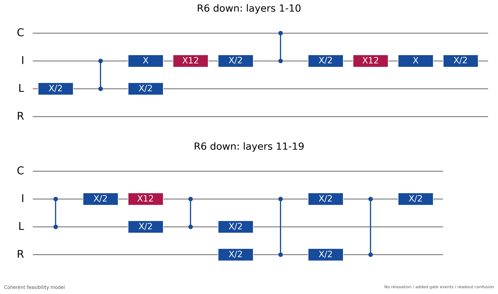
分上下两行连续阅读，第二行承接第一行末态，没有重置。每一列是可并行操作，CZ列和单门列隔离。X/X/2/X12只标旋转类型，实际轴相位、配对旋转和虚拟帧包含在冻结参数及矩阵中；这不是把全部驱动轴都设为X。四线顺序C,I,L,R。

## 9. 波形setup与实际模拟层次

局域四位频率C/I/L/R为4.600/5.000/5.500/5.650GHz，非谐性为-0.220/-0.220/-0.220/-0.235GHz。每位四能级，原生传播步长0.1ns，选中边耦合与频率平滑变化，其他边在该参考中关闭。

01门通常32ns，X12为40ns。三条CZ约30.642/56.371/64.820ns，调谐频率4.818938/5.244279/5.259764GHz。图显示包络和控制轨迹，不显示快速载波；轴相位仍保留。

整机使用这些局域传播过程，并对模块外搬运/跨片/存储门使用理想01过程延拓。接口单门也尚未统一替换成全部真实脉冲。故准确名称是“局域脉冲导出的整机过程基线”，不是17体连续波形仿真。

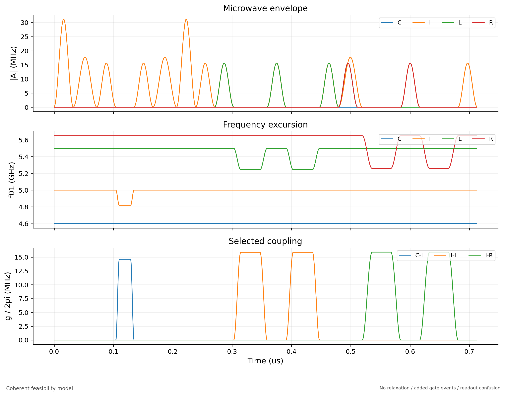
R5 down的实际冻结参考设置：微波复包络幅度、各位频率轨迹、被选边耦合。单门使用余弦包络和DRAG，CZ频率及耦合用平滑坡。图省略GHz载波快速振荡和复包络相位，不代表相位参数为零；采样约0.5ns用于绘图，门传播积分仍0.1ns。

## 10. 为什么配对旋转可以不增加CZ

把左侧两个CNOT记为K。在01入口、接收端为空时，K近似把|x,0>搬为|0,x>。前置V作用在源端，信息搬到接收端后再用V逆还原，因此逻辑搬运仍保留。

01校准不固定20与21间的相位差，因而K的2态旁路可产生额外目标旋转M。源为2时前置V保持其能级；若V第一列匹配M|0>，后置V逆就能把目标还原为0。关键是目标最初为0，且辅助块近似封闭、泄露小；剩余分支相位还要由端点帧校准。

这是一种利用受限入口的配对匹配，不是把M当作任意误差都能相消，也不是通用完整CSWAP的证明。下面固定其他参数移除配对旋转，可见需要送右端的分支目标人口下降；该消融没有再优化其他参数。

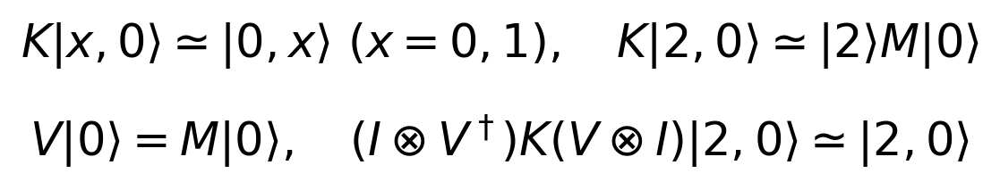

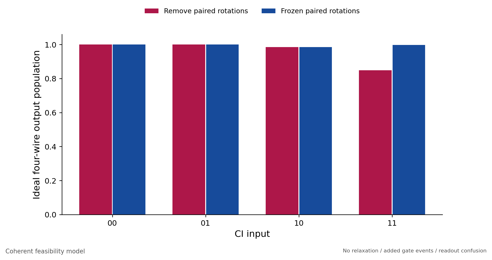
固定CZ和端点帧，移除R5前后配对旋转后的相干消融。图比较理想四位输出人口，未用额外CZ。移除后没有重新优化其他相位，因此只证明当前配对校准的作用，不证明所有无配对线路都不可行。

## 11. 中途2态可以合法占据，末态必须检查

真空入口0000也会在编码中主动经历I的2态。图中一段P2接近1是设计过程，不能直接叫作100%泄露错误。

可行性关心两个问题：这些振幅是否按设计回到逻辑空间，以及返回时是否带着错误相位或错误端口人口。本版没有弛豫复位，末态恢复完全来自相干操作。

曲线取原生层边界，不代表每个CZ内部的瞬时最大占据。对最终泄露，还需区分高能级残留、错误01态和辅助控制未恢复；不能把真值表缺失人口全部归为2态。

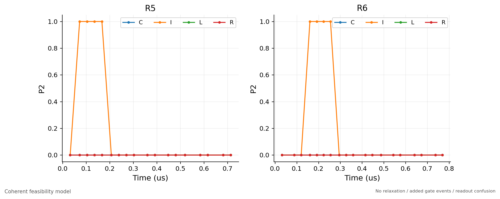
真空入口0000的原生层边界P2。辅助2态可在中途被主动占据，末态应相干恢复；没有任何耗散帮助复位。图不是波形内部每个积分点的人口，不能读取瞬时峰值。

## 12. 连续控制扫描与16态检验各自回答什么

I=1、两端为空，C连续改变。理想P1(L)=cos^2(theta/2)、P1(R)=sin^2(theta/2)，中间角度是相干路由；固定波形扫描101个theta点，不逐点重优化。

末态I应接近0，P2/P3应小，左右端连续变化。但相同平均人口也可能来自经典测控，所以人口扫描必须与下一页叠加输入的联合态检查配合。

本图四位都保留到3态，曲线中的小偏离来自冻结波形本身，未附加任何随机错误或读出处理。

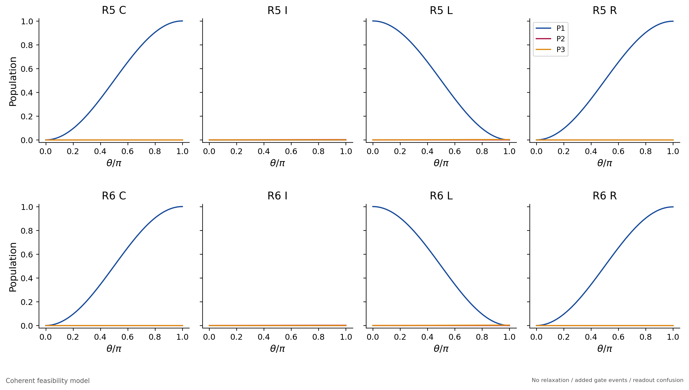
I=1、L=R=0，C=cos(theta/2)|0>+sin(theta/2)|1>，101点使用相同冻结波形。画四位末态P1/P2/P3；中间角度的相干性另由16态和通道检查验证，人口平滑本身不足以证明量子路由。

## 13. down与up的基态人口功能

四个逻辑CI标签对应四个合法基态。down输入为|c,i,0,0>，up输入为它的理想像；行按期望输出的相同逻辑标签排列。

使用完整256维局域传播子，不按输出列归一，也不筛掉辅助失败。因此接近对角的矩阵说明人口搬运近似正确，但其外的概率仍计入失败。

人口图不显示每列相位。即使这张图全对角，也可能有相干逻辑错误；这正是继续比较16态、实际往返和Choi过程的原因。

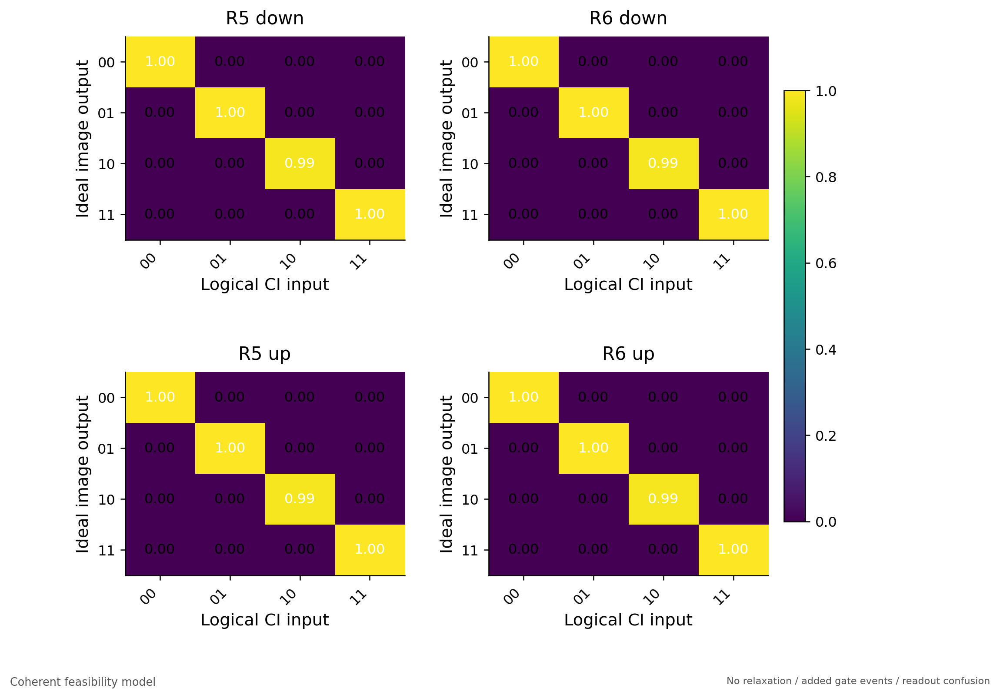
down的四列输入为|c,i,0,0>，up的四列为对应理想路由输出；行按相同逻辑CI标签标记。矩阵来自完整四能级传播，未做末态筛选或按列归一。列和缺失可以是错误计算态或高能级，不能全部叫2态泄露。

## 14. 相干down/up/实际往返

16种CI系数来自0/1/+/-直积。R5平均down、up、往返态重叠分别为99.62%/99.57%/99.32%；R6相应为99.61%/99.57%/99.44%。

up独立入口用理想合法像；往返则把真实down输出直接送入真实up，更接近QRAM实际使用。两者不必相等，因为down的小偏离会进入up原本未作为理想入口的分支。

这些是直接状态重叠，不是测量重建的QST估计，也不是通过末态后选择得到。它们支持参考节点的近似实现，不能把仍有的约千分之几残差删掉。

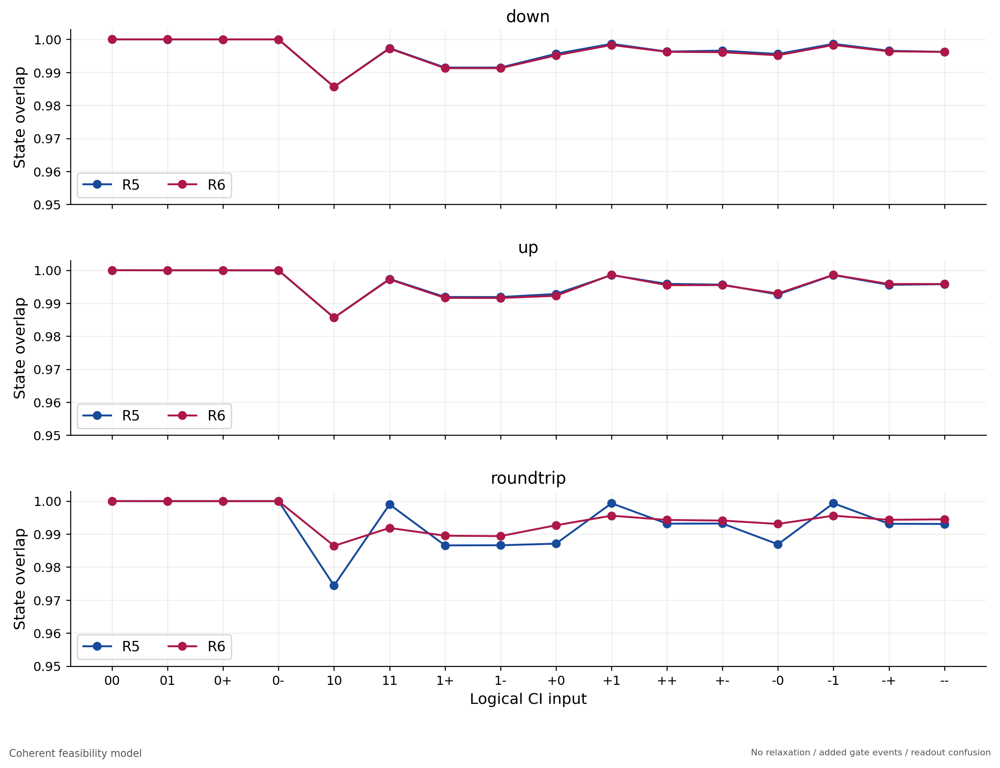
C与I各取0、1、+、-的16种系数。down直接计算CLR输出密度矩阵；up从理想合法像空间入口返回CI；roundtrip将实际down输出接实际up后计算CI。全部是直接相干态计算，没有有限shots重建或读出模型。

## 15. 完整16数据库查询的原始输出

四个基态地址检验读字，四个两分量叠加及++检验跨路径关系。D入口0，目标为AD联合态；所有临时寄存器均被迹掉，原始结果没有要求辅助成功。

两方案各144项任务：R5平均原始态重叠98.20%，范围96.31%至99.99%；R6平均98.58%。色标放大到0.9-1只是为了看清残差。

所有数据库使用同一主体，只改变存储初态。全网过程复制局域门模型，仍须满足真实每个节点能独立标定到相应过程的前提；不从这张图推导共享17位物理频率已经可实现。

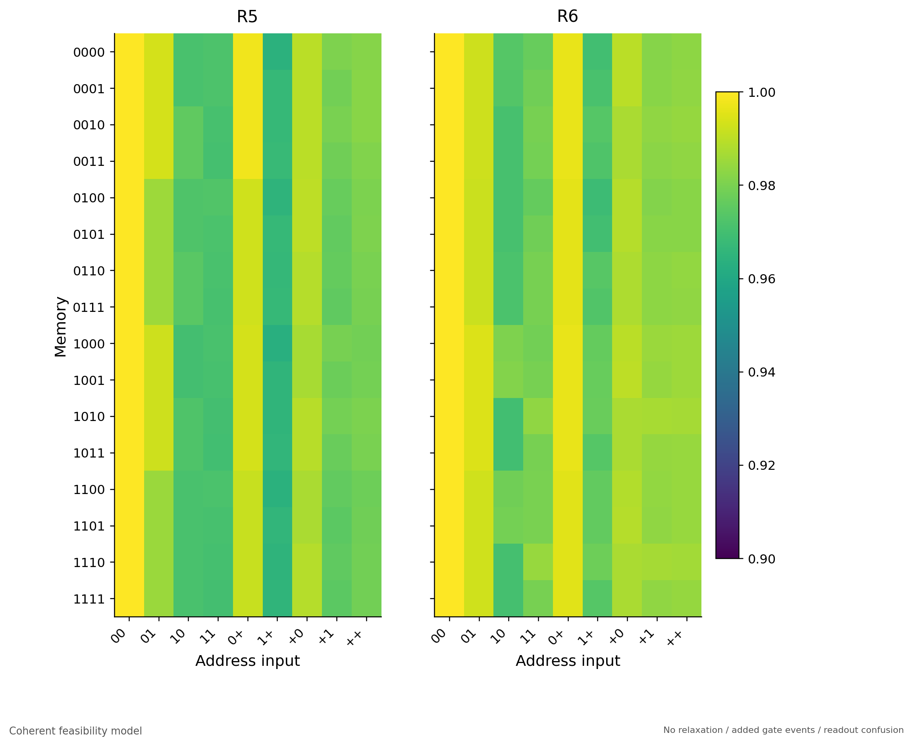
全部16数据库×9地址入口，D=0，AD联合目标态原始重叠；直接密度矩阵计算，未后选择，未重归一泄露块。色标0.9至1便于查看相干残差。两方案均用同一无耗散、无附加错误的传播口径。

## 16. 完整通道验证比挑选输入更强

三输入AD与数学参考系统制备最大纠缠，经过query后迹掉树，得到归一化Choi计算块J。Fe比较完整理想异或通道，因而也检查未逐一展示的复数输入相干；参考系统不计入17个硬件位。

16数据库平均原始Fe：R5为97.98%，R6为98.31%。右图另外显示真辅助零分支的归一化Choi重叠，接近1说明返回分支相干关系较好，但它不是一个无条件确定性门指标。

原始Fe、辅助回零概率、条件Choi重叠应一起读。条件值高不能替代左图，也不能靠丢弃失败分支宣布整机已经完美。

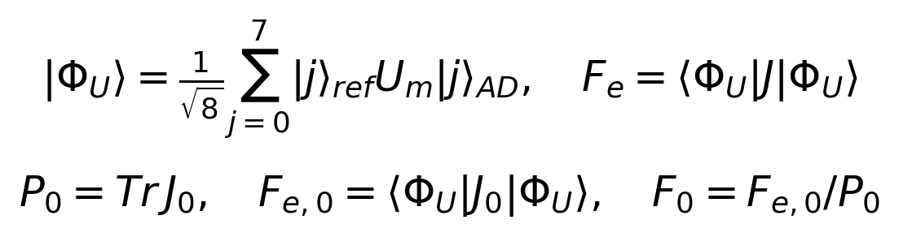

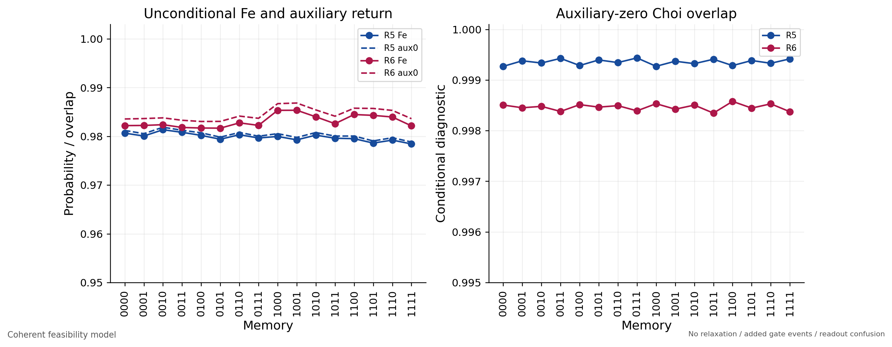
原始Fe来自完整三输入查询Choi态，检验全部复数输入关系；辅助回零概率单独显示。右图是真辅助零分支归一化Choi重叠，是条件诊断，不是确定性门保真度，不能拿它替代左图原始Fe。

## 17. 剩余相干误差主要落在哪个分支

将J按AD计算空间内外、辅助全0与否分区，可以把1-Fe严格拆成三项：AD泄露；辅助非零分支中不匹配理想的部分；辅助零分支内部不匹配。这里是一个通道分解，不是人为设定错误概率。

R5中，非零辅助分支贡献约1.953个百分点，辅助零分支内部约0.063个百分点；R6分别约1.541和0.151个百分点。因此下一步应重点定位组合后的辅助恢复。

这不等于已经确认某一个X12是源头。非零辅助也可能是错误01态，内部相位和人口干涉都可影响回零。外部AD几乎无泄露也受理想接口延拓限制，不能解释成真实芯片已解决全部泄露。

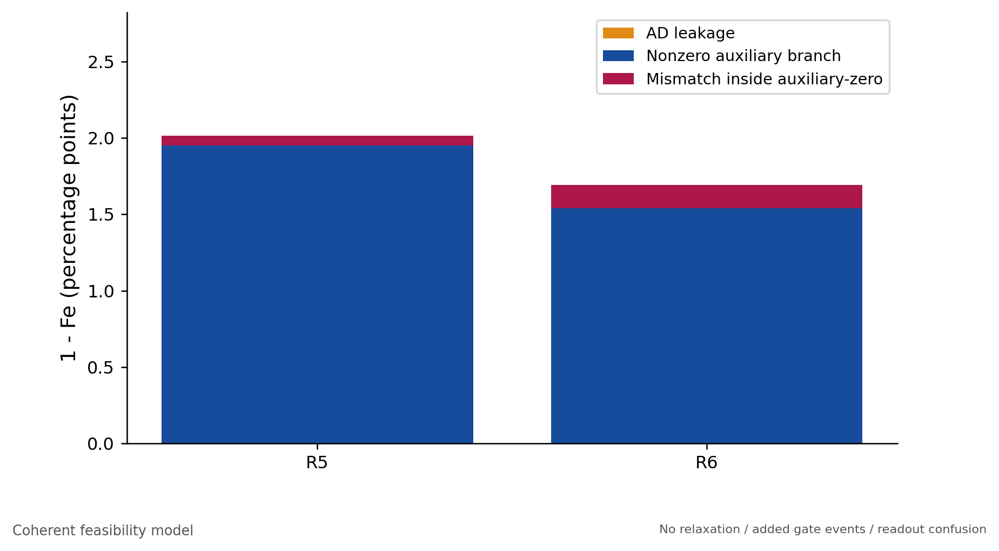
相干通道误差的严格分支分解：AD计算空间外；AD在01但辅助不为0且不匹配目标；辅助为0分支内不匹配。三项相加等于1-Fe（浮点负值截零）。这是相干残差分区，没有预设的错误概率或噪声消融。

## 18. 8×8含相位操作块

M=0010时，理想query只在地址10翻转D，所以交换100与101，其余基态不动。图中K0是真辅助全0、AD仍在01的实际块，保留复相位和原始幅度，只移除一个公共全局相位。

实部展示预期置换，虚部展示残余相位。虚部色标更细，不能直接按颜色深浅与实部比较大小。未按列归一，因此损失概率没有被藏起来。

K0通常不是严格酉矩阵。完整物理传播是酉的，但把辅助投影后得到的是一个Kraus块；其他辅助末态构成其余块，原始通道Fe已包含它们。

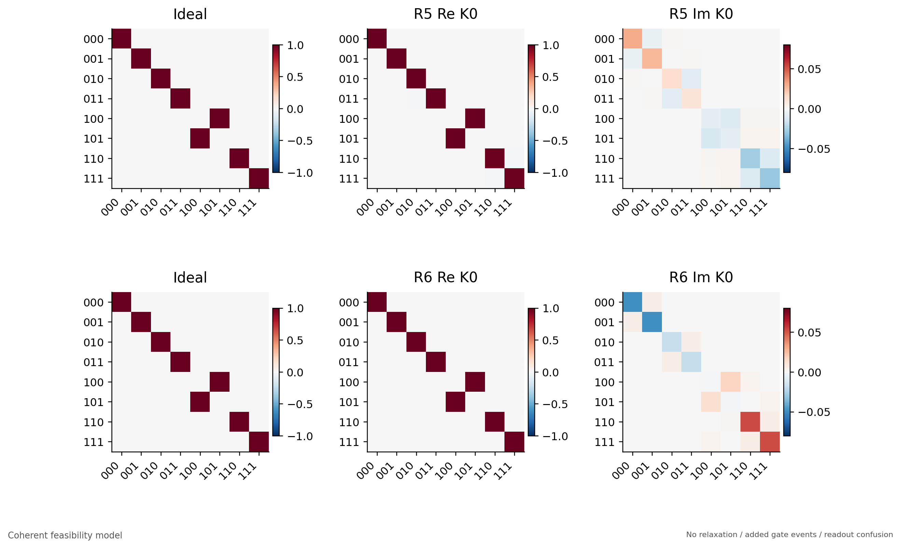
M=0010的含相位8×8 K0块，真辅助全0、AD在01，移除一个公共全局相位，不按列归一。行输出、列输入；实部±1、虚部±0.08。K0一般不是酉矩阵，完整通道还包含其他辅助末态，原始Fe已包括它们。

## 19. 同一query的8×8人口矩阵

这里直接迹掉辅助，不要求它回0。行输出、列输入，展示目标置换是否正确发生。其数据来自同一完整Choi矩阵，不是另造一个理想真值表。

人口图看不到每列的复相位，所以它与上一页应同时展示。相位关系错时，这张图可能仍接近理想，但后续Grover会明显失败。

当前接口过程不会把外部AD主动驱动到高能级，因此外部AD泄露很小是模型边界之一。实际接口的完整脉冲、串扰和高能级响应尚未验证。

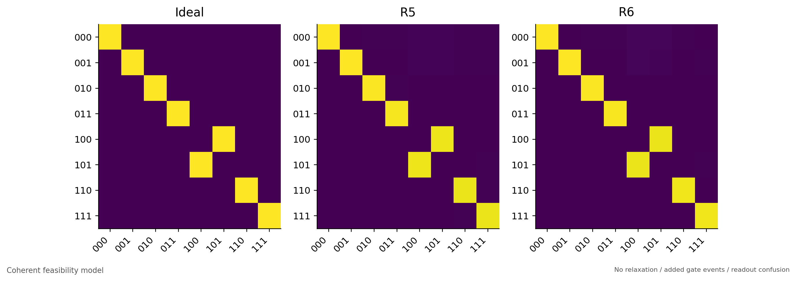
同一数据库的8×8计算基转移人口，实际图迹掉全部辅助状态，不要求辅助回零。它检查人口功能，上一图及过程Fe检查相位，三者不能互相替代。外部AD泄露在当前理想接口延拓中受到限制，不能据此预测真机无泄露。

## 20. 输出虚拟Z能修什么，不能修什么

对返回分支，先扣除理想数据库标记相位，再定义四个地址的残余epsilon。Delta=epsilon00-epsilon01-epsilon10+epsilon11不随两个输出局域Z变化，非零Delta提示还有不能由这两个Z清除的条件相位。

本图的振幅先投影到辅助全0、D恢复为->，所以它只诊断这条返回分支，不把混合原始态简化成四个相位。完整原始Fe仍是主验证。

线路末端单独加对角虚拟Z不会提高辅助回零概率；在中间重标定驱动轴相位可能改变返回干涉，需要另外验证。这也是定位残余时要同时检查配对旋转、回程和帧的原因。

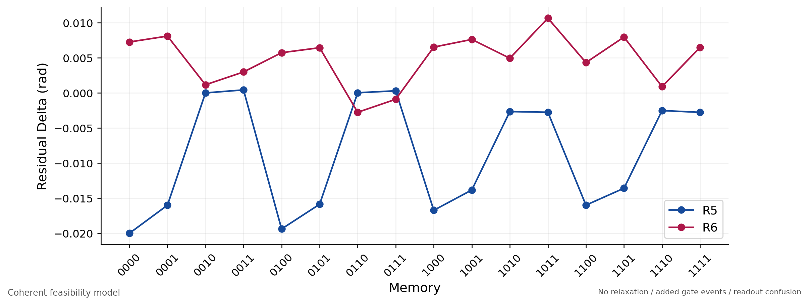
在辅助全0且D恢复为->的投影振幅上，扣除理想(-1)^m后计算Delta=epsilon00-epsilon01-epsilon10+epsilon11。它对两个输出局域Z不变，只诊断返回分支的非局域相位；不把混合原始态硬解释成四个相位。

## 21. GHZ输出直接检验跨地址相干

Bell地址(|00>+|11>)/sqrt2，D=0，M=0101，理想AD目标为(|000>+|111>)/sqrt2。图中两个角点人口与它们之间的非对角项一起出现，说明不只是读对两个经典分支。

未经后选择的GHZ态重叠，R5为98.47%，R6为98.63%。它们来自直接密度矩阵，没有有限shots或读出混淆。虚部反映相对相位残差，仍保留在比较中。

该图是实验QST的理想分析参照，而不是真机测量结果。实际表征还需准备与分析脉冲、012辨识和联合读出校准；本报告不让这些测量误差掩盖线路功能。

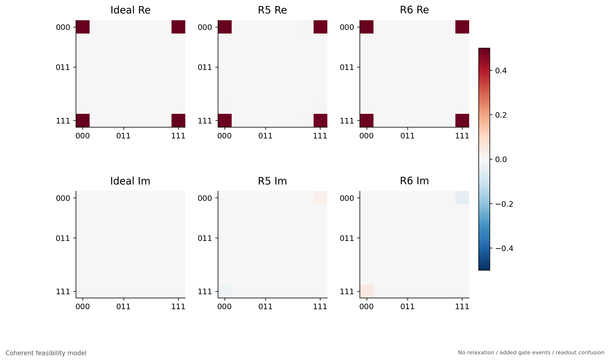
Bell地址、D=0、M=0101，理想目标GHZ=(|000>+|111>)/sqrt2。原始AD密度矩阵，未后选择。非对角角点检验相干，虚部检验相位。这里是直接状态计算，未模拟测量重建。

## 22. 四目标Grover闭环

四次任务只改变数据库为1000、0100、0010、0001。QPU始终准备地址++与D=->，执行同一个query和同一个diffusion。目标标签不进入查询主体。

不后选择的平均物理地址成功率，R5为98.90%，R6为98.72%。这是当前参考过程的相干线路结果；没有任何预设门事件或分类误判。它支持单轮功能可行，不是实际硬件的速度优势证明。

成功率接近99%仍有残差；完整三输入通道Fe约98%也比这个特定算法任务更严格。不能把某个易于通过的任务当成完整未知输入上的完美查询。

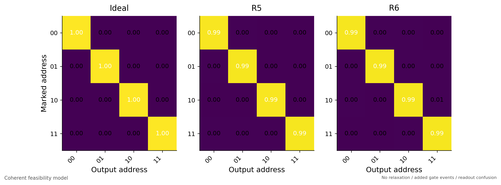
四目标使用完全相同的QPU、query和diffusion，仅改变存储one-hot。行目标、列物理计算地址；无二值分类、无shots抽样、无附加门事件。图中99%左右是当前脉冲导出过程模型的相干结果，不代表真实芯片性能。

## 23. 从相位oracle到目标人口

目标10时，oracle主要改变10与其他地址之间的相干符号，人口仍近似均匀；diffusion再把该差异转为目标10的人口。图把这两个动作串起来，避免只靠最终一个成功率判断线路。

三个时刻使用同一固定前缀，初始列是理想入口++，后两列是实际冻结过程的快照。计算块没有另行归一。

若query后相干已经错，应检查路由与访问；query正确而diffusion后不集中，再检查QPU扩散门。这个顺序比在最终成功率上同时盲调所有相位更容易定位。

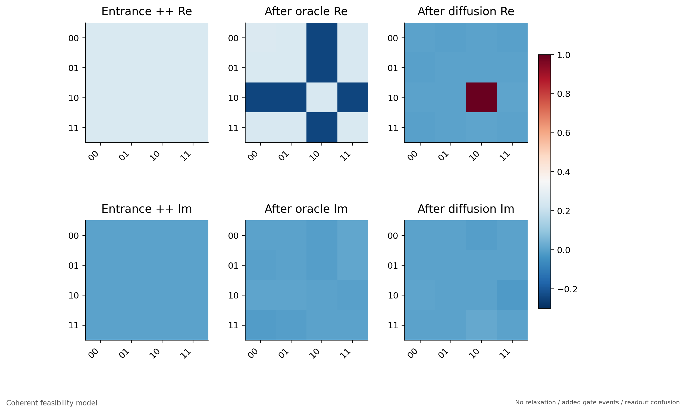
R5目标10。oracle基本不改变均匀人口，却翻转10与其余地址的相干符号；diffusion将该差异转为目标人口。两个阶段来自同一次相干传播，入口制备为理想态，未假装已验证其真实制备波形。

## 24. 沿整条线路检查辅助恢复

阶段末P1/P2展示地址写入、数据路由、访问及卸载。中途控制位有1、端口有2都可能是设计本身；关键是解码后临时树是否接近真空，以及返回相干是否正确。

图上仍能看到小的末态辅助残留，与通道分解相符。但阶段热图只用于定位，不直接证明某个物理机制。需要时可继续把异常阶段拆到原生层和单个波形。

本版没有耗散帮助清零，所有返回均由线路完成。对多次复用的QRAM，残留会破坏下一次部分router的理想入口条件；这里验证一轮，不把成功率简单乘方当作多轮预测。

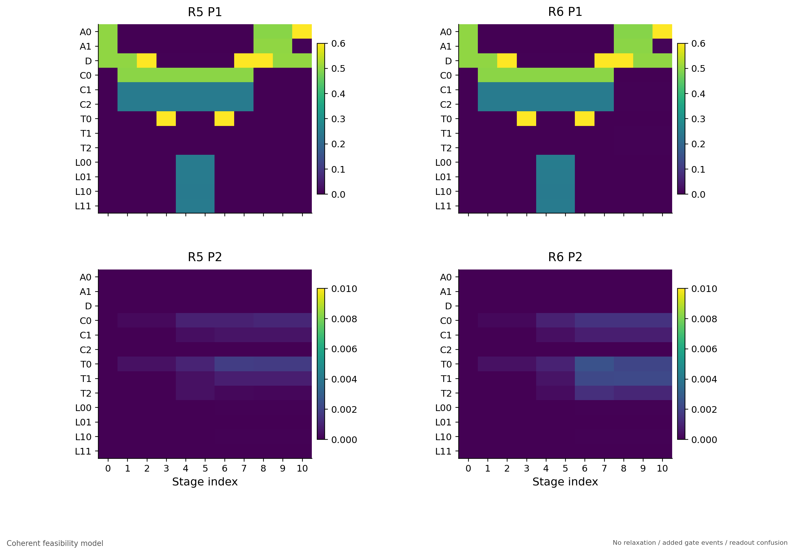
M=0010、地址++、D=->。0制备、1地址加载、2编码、3数据入树、4下行、5访问、6上行、7数据返回、8地址卸载、9解码、10扩散。P2是阶段末，不等于波形内部峰值；颜色按同一能级统一范围，回零完全来自相干操作。

## 25. 原生门资源与允许的并行

完整一轮R5为105个CZ、288个物理单门，CZ层深86；R6为113、272及92。计数包含已展开的H，虚拟帧不占脉冲时长。

不相交单门可并行，不相交CZ可并行，单门层与CZ层隔离；子树router可在相同类型层并行，根与共享子端口不能同时占用。四个叶端存储CZ独立并行。

105与113包含路由、控制存取、跨片接口、QPU中转、存储访问和diffusion；不是只有节点的5/6个CZ。10-CZ参照只替换路由核作同拓扑资源估算，没有声称其脉冲性能或全局最少门数。

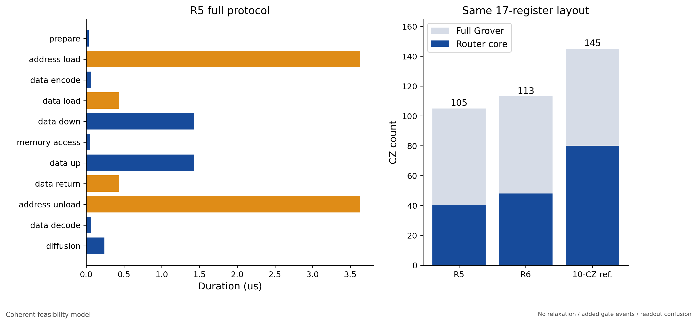
左：含制备等待、地址搬运和恢复的总时长分解。右：同一参考拓扑和完整SWAP口径下的CZ计数，R5/R6已由实际编译器计数；10-CZ只替换路由核进行资源估算，没有冒充其脉冲性能。105/113/145均含一次diffusion的1个CZ。

## 26. 扩展资源与相干趋势

显式端口、显式存储、独立外部A/D的工作位数4N+n-1，为8、17、34；本串行注入协议router调用数4N-2n-4，为2、8、22。它是一个可审计参考协议，不是最优资源证明。

图中query时间都不含diffusion；CZ总数只有n=2含一次diffusion，所以跨规模比较query门数时n=2要减1。H均按两脉冲展开。

当前所有时长不产生寿命损失，只是实验资源设置。真正需要优化的是在相同功能和帧约定下减少资源；接收端已知为零的两CNOT转移可研究，但不能不证明回程就替换全部SWAP。

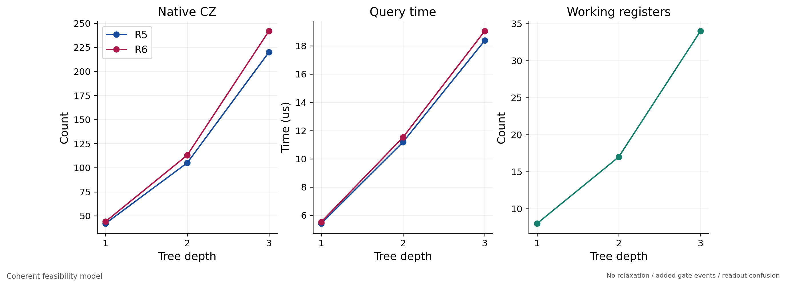
1至3层参考协议的实际资源。n=2的CZ总数含diffusion，n=1、3不含Grover diffusion，因此查询数比较时n=2需减1；时间图统一只比较query。工作位数4N+n-1=8、17、34。串行地址注入和完整SWAP并不代表资源最优。

## 27. 1至3层的相干phase-query

这里固定均匀地址、D=->，分别用全1和单目标数据库。无T1/T2、无附加错误也会随模块数增加累积相干残差，说明局域高重叠不能直接保证任意规模组合完美。

全部使用bond128；只有两种数据库模式，没有声称三层所有数据库和所有输入都已全面验证。图是一次query，不是不同规模Grover的最优迭代性能。

规模趋势是在相同模块过程假设下的探索。要对真实大树下结论，仍需每节点门库、共享端口工作点和接口模型，而不能把这里同质复制的过程直接当作一套真实器件配置。

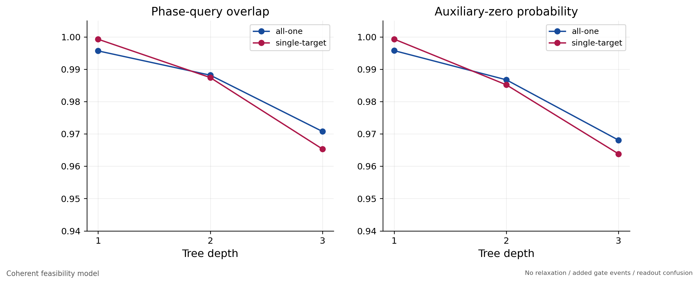
R5的1-3层相干phase-query，均匀地址、D=->，全1或单目标数据库。全部用bond128。只有两个数据库模式，不是所有三层输入的全面验证，也不是不同规模Grover的最优轮数或可扩展性证明。

## 28. 数值与能级截断是否可信

局域冻结参数同时检查0.1ns与0.05ns步长，并从四能级增加到五能级。没有重新优化门参数；图中变化检验传播和截断敏感性，而非展示新的校准提升。

整机主结果用bond128，另对目标10的R5/R6用64重算。完整query Fe的64与128差分别约2.18e-06, 3.79e-05，小于当前百分比量级相干残差。三层尚未做全输入、更大bond的严格误差界。

累计截断权重只是数值诊断，不直接当成最终保真度误差。状态正性、迹、辅助选择界及完整原生理想矩阵也经过独立检查。

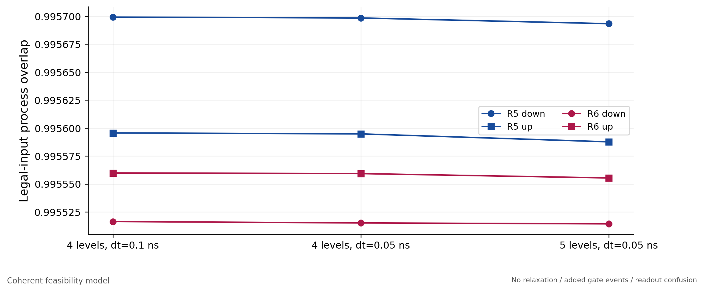
冻结同一脉冲参数，分别细化积分步长和增加截断能级，比较down/up四维合法输入的过程重叠。没有在5能级重新优化参数。检查只覆盖局域节点，不能替代整个17体连续Hamiltonian验证。

## 29. 真机线路可行性还需要核验什么

首先确认17个角色对应的真实比特和连边。这里的三节点过程是同质复制，没有给出一套同时满足共享T1/T2端口的17位工作频率。注意这里T1/T2是树端口名称，不是寿命时间。根节点的子端口与子节点中心是同一物理位，不能分别假定它同时处于两个工作频率。

实际可通过分阶段调谐或按各节点真实工作点分别校准来实现，但频率转场、等待相位、跨块参考帧必须进入控制编译器。现有四位节点波形不能不改参数就保证复制到整棵树。

其次校准QPU中转、D-T0跨片、存储访问和H分解的真实脉冲，检查高能级、六态往返和空query。最后依次做两路径Ramsey、16数据库查询、GHZ、oracle与diffusion闭环。当前报告给出这些实验的目标，不把理想接口假设当成已经完成的硬件验证。

| 已具备的证明 | 仍需真实系统补齐 |
| --- | --- |
| 允许门集的精确矩阵构造 | 实际角色到比特/coupler映射 |
| 合法输入与临时树恢复的理想证明 | 每节点工作点、共享端口与帧 |
| 局域四能级波形近似实现 | 接口/跨片/存储/H分解真实波形 |
| 过程组合和单轮算法基线 | 实际多轮复用与读出表征 |

## 30. 最终判断与下一步优先级

从线路结构看，方案可行：所需门集可构建，部分router的输入域可在理想协议中维持，固定数据库访问与相干返回给出正确query，四目标Grover闭环成立。

从当前参考控制看，局域脉冲和整机过程给出接近目标的相干结果，但仍有辅助恢复与相位残差。先用真实down-up和空query定位这些残差，再调整组合校准；不能只在末端加Z就期待人口损失消失。

从完整真机实现看，结论是“具备值得落地验证的线路方案”，尚不是“真实17位器件已经证明可运行到该精度”。最优先补齐共享工作点与接口门库，并保持相同字序、帧和并行约束。这一层证据补齐后，再讨论寿命、读出和系统误差预算。

## 附录A：四目标原始结果与返回诊断

所有数字均为相干直接计算，无随机事件或测量采样误差。条件列只是真辅助全0分支的诊断，不能替代不后选择成功率。

| 方案/目标 | 原始成功 | 辅助全0概率 | 条件成功 | 联合正确 |
| --- | --- | --- | --- | --- |
| R5/00 | 98.86% | 98.52% | 99.95% | 98.47% |
| R5/01 | 98.79% | 98.42% | 99.95% | 98.37% |
| R5/10 | 99.19% | 99.02% | 99.95% | 98.98% |
| R5/11 | 98.76% | 98.40% | 99.96% | 98.35% |
| R6/00 | 98.79% | 98.65% | 99.85% | 98.51% |
| R6/01 | 98.63% | 98.40% | 99.85% | 98.25% |
| R6/10 | 98.67% | 98.37% | 99.85% | 98.22% |
| R6/11 | 98.80% | 98.57% | 99.86% | 98.43% |

## 附录B：完整查询通道的平均诊断

按16数据库等权平均。条件Choi重叠是逐数据库归一后的均值，不能直接用几个均值的乘积替代联合量。AD无泄露受理想接口延拓限制。

| 方案 | 原始Fe | Haar平均态重叠 | 辅助0概率 | 条件Choi重叠 |
| --- | --- | --- | --- | --- |
| R5 | 97.98% | 98.21% | 98.03% | 99.94% |
| R6 | 98.31% | 98.50% | 98.45% | 99.85% |

## 附录C：主要文件与重现入口

本修订版单独命名为线路可行性报告，当前正文与主图只读取feasibility中的相干数据。旧门误差对照版本归档在archive_gate_error_version，旧数据保留。

feasibility_data.py重新传播展开H的完整线路；feasibility_checks.py直接验证原生理想构造；feasibility_plots.py生成数据图；feasibility_report.py输出本报告。document.py作为当前报告入口，README列出完整命令。

| 内容 | 文件 |
| --- | --- |
| 冻结设置和引用 | feasibility/manifest.json、pulse_sources.json |
| 完整原始通道和K0 | feasibility/arrays/*.npz、cases/*.json |
| 理想原生角度和检查 | feasibility/checks.json |
| 局域/阶段/规模 | local.npz、tracking.npz、scaling.json |
| 积分与截断 | pulse_convergence.json |
| 图与正文 | feasibility/figures、results/REPORT.md |
| 协议与文献参照 | TASKS.md；arXiv:2506.16682v1的10-CZ节点口径 |
